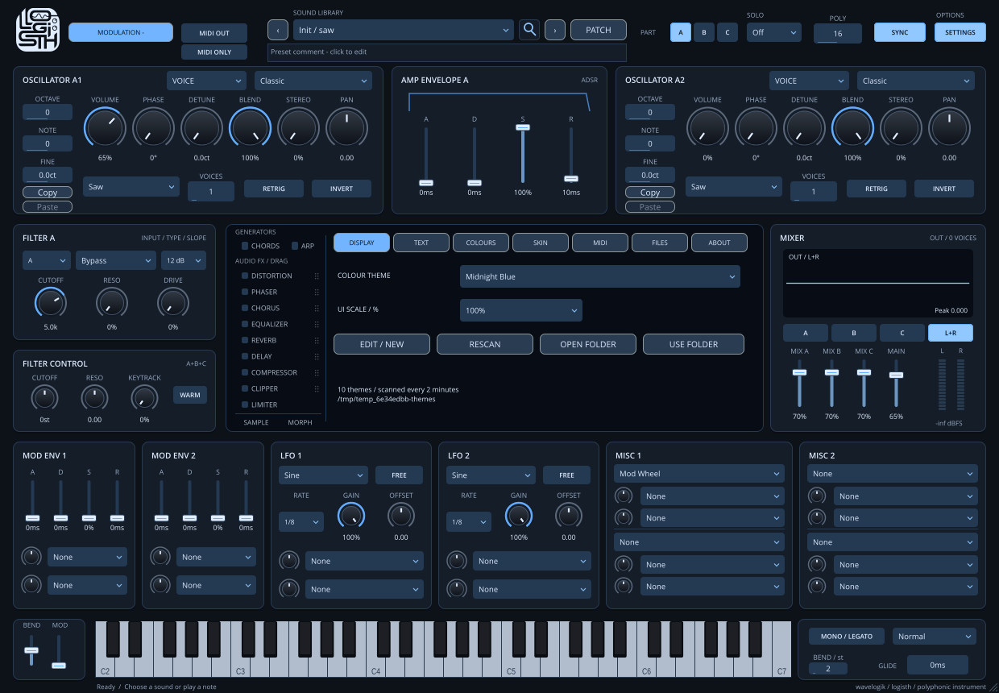

# logisth 1.0.1

**wavelogik logisth — a three-part polyphonic subtractive synthesizer with a compact single-window console.**
VST3, CLAP and Standalone for Windows, macOS and Linux. Built with JUCE and an
independent synthesis engine.

[User Manual](docs/MANUAL.md) · [Technical Manual](docs/TECHNICAL_MANUAL.md) ·
[Technical Manual PDF](docs/logisth-Technical-Manual-English.pdf)



## New in 1.0.1

Set or automate both sample boundaries directly above the waveform for A1 through C2. The header and About panel give the AP logo and caption a shared layout. Long sampler and granular notes survive a same-rate graph restart on a continuous transport. MIDI cleanup and pending sample imports are scoped to their owner. [Release notes](docs/RELEASE-v1.0.1.md) · [Playback measurements and test method](docs/REVIEW-v1.0.1.md)

## New in 0.9.8.3

Distortion adds optional **Multiband** routing with 1–4 parallel bands, draggable
crossovers, per-band models/Drive/Mix/On, and independent pre/post spectrum and
display tilt. **Legacy** retains the four-stage serial path and older patch sound.
SETTINGS > SKIN adds **GRADIENT** and **GRID** amount sliders. Gradients now show
inside panels as well as the canvas; both amounts travel with portable themes.
ABOUT adds mixedbytrzy's testing and interface contributions.
See the [multiband and appearance review](docs/MULTIBAND_REVIEW.md).

## New in 0.9.8.2

Use the header MODULATION button to fold the entire Mod Env/LFO/Misc row.
The window becomes 220 pixels shorter at 100%, with the keyboard moved up and
all modulation still active. Layout and fractional scale survive editor reopen.
SKIN now includes 20 original generated backgrounds, two for each factory theme,
ready offline from the built-in background chooser. The top highlight line is removed.
See [Compact Layout and Backgrounds](docs/COMPACT_LAYOUT.md).

## New in 0.9.8.1

Text now renders directly at the current display scale, without resizing a
full-interface bitmap. TEXT offers Native, Grayscale, 2x/4x supersampling,
AA Off and edge weight 50–200%. Fractional resizing keeps a uniform aspect ratio.
FILES adds CHOOSE/OPEN for the library, preset load/save, samples and IRs.
SKIN imports portable PNG/JPEG backgrounds, adds image/grid combinations and
image/panel opacity controls. Distortion has a reserved title row; redundant
headings behind inline controls are removed. Patch and effect context menus
follow the selected theme. Audio parameters and DSP remain unchanged.
See the [appearance review](docs/APPEARANCE_REVIEW.md) for validation and limits.

## New in 0.9.8

Version 0.9.8 adds four independently enabled/reorderable distortion stages,
pre/post stereo-power EQ spectra with five display slopes, stable Chorus layout,
categorized Settings and persistent font size/style/antialiasing preferences.
Preset save/load, sample import and IR import remember their own directories.
The project-owner SVG replaces the standard header mark; the AP artwork is unchanged.
See the [GUI/DSP review](docs/GUI_DSP_REVIEW.md) for measurement fixtures and limits.
The published v0.9.7 assets remain unchanged.

## New in 0.9.7

- **Movable audio rack:** drag an effect, use Alt+Up/Down, or right-click for
  Move/Reset. Eight effects, including Clipper, follow the saved order in actual
  DSP. A short fade switches live orders without duplicating the state bank.
  Main and the final Limiter remain fixed at the output.
- **Separate generators:** Chords and Arp share a dedicated top row; Sample and
  Morph remain tools. New editors open **Sample** first.
- **32-note polyphony**, with **16 as the default**. All four source engines and
  prepared Signalsmith streams support the extended range. The previous 1070
  host definitions remain intact; one companion control is appended.
- **Readable skins:** Light screen knobs use the correct dark surface. All ten
  themes and three knob styles receive cached contrast-aware needles/arcs/tracks;
  supplied theme JSON and fonts remain unchanged.
- **Host refresh:** combined POLY/detune values and expanded routing menus use
  incoming parameter values, fixing a display that could lag one host update.
- **Tail safety:** idle detection accounts for the combined first-response time
  of a sparse IR and Delay, in either order. Unused processing still bypasses/sleeps.
- Updated English user/technical manuals, contrast evidence, regression coverage
  and native packages for Windows, Linux and macOS Universal.

[Rack and skin review](docs/REVIEW-v0.9.7.md) · [Release notes](docs/RELEASE-v0.9.7.md)

## New in 0.9.6.2

- **Modern compressor** with a variable soft knee, makeup, parallel mix, live
  transfer curve, waveform and gain-reduction meter. Old presets retain Legacy.
- **Clipper**: Hard/Soft curves, Drive, Ceiling, Knee, Mix and optional first-order
  antiderivative antialiasing (ADAA). Live input/output waveform and knee plot.
- **Output limiter** after Main, with stereo linking, adjustable ceiling/release,
  input drive and live reduction/activity. Zero-added-latency sample-peak limiting.
- **IR waveform and drag/drop** inside Convolution, with cached stereo extrema
  built during background import. WAV, AIFF and FLAC; IR remains embedded.
- **Ordered rack**: Chords, Arpeggiator, audio effects in signal order, then tools.
- **CPU**: direct bypass for disabled effects, safe sleep after silence/tails,
  selected-model reverb configuration, active FM/AM dependency tracking and no
  audio rendering in MIDI-only mode. Graph capture runs only for the visible page.
- The 1055 previous parameter definitions are intact; 15 controls are appended.

[Compressor](docs/images/logisth-compressor.png) · [Clipper](docs/images/logisth-clipper.png) ·
[Limiter](docs/images/logisth-limiter.png) · [Performance and dynamics](docs/DYNAMICS_CPU.md) ·
[Release notes](docs/RELEASE-v0.9.6.2.md)

## New in 0.9.6.1

- **Stereo width corrected**: 100% fully separates unison groups. Measured L/R
  correlation is 0.003 and Side/Mid −0.03 dB with eight detuned saw voices.
  At 0% the signal is exactly mono. Full Pan moves the complete oscillator.
- **MORPH targets** group A/B/C symmetrically by function, including local
  cutoff, resonance and mix targets for every part.
- Small **Copy / Paste** buttons in each oscillator include its complete settings,
  envelope and source audio. The private clipboard also works between instances.
- **Reverb levels calibrated**, equal-power Dry/Wet and a common ±24 dB Wet Gain.
  Reverb Off clears its tail. Five algorithmic models remain available.
- **Convolution** adds zero-latency partitioned IR processing using JUCE.
  Load mono/stereo WAV, AIFF or FLAC; the IR is embedded in presets and DAW state.
  Normalise compensates the actual resampled IR energy; Reset IR selects the
  included chamber response. Preparation/import and retirement happen off audio.
- This version intentionally changes stereo/reverb sound and extends two choice
  ranges. A new frozen 1055-parameter baseline protects subsequent versions.

[Convolution](docs/images/logisth-reverb-convolution.png) ·
[Stereo/reverb measurements](docs/STEREO_REVERB_CALIBRATION.md) ·
[Release notes](docs/RELEASE-v0.9.6.1.md)

## New in 0.9.6

- Symmetric modulation scopes **A, B, C, A+B, A+C, B+C and A+B+C**, with
  individual player targets where applicable. Menus are grouped by function.
- **400 ct detune**, with a finer low range (100 ct at the knob midpoint).
  A new **BLEND** knob in every player's VOICE page controls its added unison
  voices; 0% retains a single tuned center, including even unison counts.
- **Settings → Appearance → Fix MIDI velocity to maximum** ignores note velocity
  for synthesis and generated MIDI. Off by default; stored with the instance/patch.
- **Graphic EQ**: 16 independent band slots, Add/Remove, per-band frequency, Q,
  enable and eight filter shapes. A selected-band inspector replaces crowded
  faders; graph axes and labels have separate space. Legacy shelves remain available.
- **About** is scrollable and includes Logik, coldwave, Moander and bokkenmmb.
- All 954 previous host parameter definitions remain intact; 99 additions follow
  them, for 1053 total. Existing presets keep full unison blend and normal velocity.

[Graphic EQ](docs/images/logisth-eq-graphic.png) · [Unison controls](docs/images/logisth-unison.png) ·
[About credits](docs/images/logisth-credits.png) · [Release notes](docs/RELEASE-v0.9.6.md)

## New in 0.9.5

- **Part C**: independent C1/C2 players, each with Classic, Wavetable, Sampler
  and Granular engines, source envelopes, FM/AM/PWM and stretch controls.
- Filter C, Amp Env C, Mix C, Solo C and a dedicated C scope source. Shared
  FILTER CONTROL affects A/B/C. Filters accept any source combination or None.
- C1/C2, C and A+B+C modulation destinations; C modulation sources and macro
  targets. Existing A+B destinations continue to address A and B only.
- **Loop Tail**: play the complete sample selection once, then repeat independent
  tail IN/OUT points. Sampler → LOOP TAIL includes enable and crossfade controls;
  Alt-drag in SAMPLE edits the tail without moving the main START/END selection.
- **200 ct detune** in every player. All 736 previous host parameters retain
  their IDs, order, ranges, defaults and choice lists; additions follow them.
  Older presets start with C silent, tail loops off and no extra detune.
- 954 host parameters; frozen parameter-contract and A/B audio comparisons join
  the native test suite. The existing 58-entry factory library remains available.

[Part C](docs/images/logisth-part-c.png) · [Loop Tail](docs/images/logisth-loop-tail.png) ·
[Release notes](docs/RELEASE-v0.9.5.md)

## New in 0.9.4.1

- Four supplied themes: **bokkenmmb-Solarized**, **bokkenmmb-Tokyo Night**,
  **bokkenmmb-Solarized Osaka**, **bokkenmmb-gruvbox**; ten themes in total.
- Embedded **IoskeleyMonoTerm Nerd Font Mono**, Regular/Bold from Ioskeley Mono
  v2.2.0. The exact unmodified fonts and supplied JSON files are verified by hashes.
- Theme changes now restyle existing editor text and search colours while retaining
  selections. Search closes on Escape from the result list and when opening Settings/PATCH.
- SETTINGS matches the adjacent SYNC button, including its theme font and state styling.
- Four-part release tags, full version strings and native bundle metadata are validated.
- The 58-entry sound library and 736 audio parameters are retained.

[Theme gallery](docs/THEMES.md) · [Review and fixes](docs/REVIEW-v0.9.4.1.md)

## New in 0.9.4

- **Signalsmith Stretch** replaces the Spectral label and uses upstream 1.3.2.
- Independent Rate, Semitones, Tonality Limit, Formant, Block (ms) and Overlap
  controls for A1/A2/B1/B2, in a compact Sampler → STRETCH page.
- Shared controls work with other applicable sampler algorithms. Window changes
  prepare outside audio processing, with bounded pools and safe live/muted handoff.
- Upstream source hashes and stereo DSP conformance tests. See the
  [algorithm/project review](docs/PROJECT_REVIEW.md).
- Preset search with a magnifying-glass button, keyboard selection and user folders.
- 48 new authored patches in eight categories, descriptions and performance macros;
  58 factory entries in total. [Preset catalogue](docs/FACTORY_PRESETS.md), native bank, demo and level report included.
- 736 automatable parameters; VST3, CLAP and Standalone remain supported.

[Preset search](docs/images/logisth-preset-search.png) · [Stretch controls](docs/images/logisth-signalsmith-stretch.png)

## New in 0.9.3

- Width/PWM works across every Classic wave, Wavetable, Sampler and both granular
  models. Periodic waves use phase distortion, sample players warp their read
  windows, and noise uses duty-controlled gating. PWM can sync to tempo.
- FM/AM modulators select internal Sine or any A1/A2/B1/B2 player. Muted players
  can still modulate; cycles use bounded previous-sample signals.
- Sampler adds Tonal, Transient, Spectral and **Kick** modes. Spectral/Kick use
  the MIT-licensed Signalsmith Stretch library. Kick retains a configurable
  0–100 ms attack, then crossfades to its pitched/stretched tail. This is an
  independently designed attack/tail processor.
- Drag a range in SAMPLE after wheel zoom, adjust START/END handles, double-click
  to fit, right-click to reset. Granular trim is separate from its scanner position.
- **MORPH** rack: four named macros, four routes each, individual From/To ranges;
  **MUTATE** with OSC/FILTER/MOD/FX locks and one-step Undo. Stored in presets.
- Live player traces, warped wavetable previews and modulation rings.
- Sixth standard theme: **AP always flexin'!**, black with blue/cyan/violet accents
  and a white AP mark. The handwritten signature has been removed as requested.
- 712 host parameters. Existing sound defaults and unity-sine calibration remain.

[AP skin](docs/images/logisth-ap.png) · [MORPH](docs/images/logisth-morph.png) ·
[Kick controls](docs/images/logisth-kick.png) · [English manual](docs/MANUAL.md)

## New in 0.9.2

- **Equalizer:** corrected Legacy bass/treble shelves, plus a 10-band Graphic EQ
  with draggable response points, faders, double-click reset, output trim and
  explicit Auto Gain. Boosting a Legacy shelf no longer silently attenuates
  every frequency. Smooth parameter changes and mode transitions.
- **Source modulation:** independent FM index/ratio, AM depth/ratio and pulse
  width/PWM for each player. The routing matrix adds individual A1/A2/B1/B2,
  part A/B and A+B targets for FM, AM and pulse width. MOD ENV 1/2 start at zero.
- **Classic waves:** White noise, Pink noise, Brown noise, Organ and Folded sine
  alongside the periodic waveforms already available.
- **Sampler PLAYBACK:** Off, Tape, Granular and WSOLA stretching, 0.125–8× time
  factors, plus Linear, Cubic, Sinc 16 and Sinc 32 resampling. Tape links time and
  pitch; Granular/WSOLA separate traversal speed from played-note pitch.
- **Themes:** choose the save file/folder, rename a custom theme, select a font,
  background and knob style, and edit 12 palette colours. The STYLE tab keeps
  these controls inside the rack. Temporary edits survive editor recreation;
  theme folders are polled every **two minutes**, with immediate manual Rescan.
- **Reverb:** rebuilt Hall and denser 16-line delay networks, eight input
  diffusers per channel, adjustable Diffusion and four-window Shimmer shifting.
- 635 automatable audio parameters and 59 modulation destination entries.

[Graphic EQ](docs/images/logisth-eq-graphic.png) ·
[Sampler playback](docs/images/logisth-sampler-playback.png) ·
[Oscillator modulation](docs/images/logisth-source-mod.png) ·
[Theme styles](docs/images/logisth-theme-style.png)

## Fixed in 0.9.1

- PHASE is available in A1/A2/B1/B2 Classic and Wavetable with RETRIG off or on.
- The knob applies a live phase offset, including held notes and host automation.
  RETRIG controls whether new notes start at a fixed or random phase.
- Knob changes use a short cyclic smoothing ramp; 0/360 degrees are equivalent,
  and crossing the boundary takes the short path. Phase modulation remains additive.

## New in 0.9.0

- Manufacturer: **wavelogik**; product: **logisth**. Original code/documentation
  use the MIT license. Plug-in metadata uses `com.wavelogik.logisth` and the new
  manufacturer code; hosts see a new instrument identity. Existing .logisth
  sound presets remain readable.
- SETTINGS / APPEARANCE remembers exact window dimensions and typed scaling
  from **80–200%**, including decimals. The last percentage remains visible and
  new/reopened instances restore it. Resizing does not affect the audio patch.
- Five standard themes are written as editable JSON files in the user's
  `logisth/themes` folder. Theme Editor previews all ten palette roles, accepts
  RGB hex colours, and saves custom copies. Open Folder and Rescan are available;
  automatic scans now discover installed/edited files every two minutes (0.9.2).
- REVERB adds **Room, Spring, Vintage and Shimmer** alongside Hall. Room has
  early reflections, Spring uses dispersive all-passes, Vintage has filtered,
  saturated feedback and wow/flutter, and Shimmer uses granular pitch-shifted
  feedback/excitation. Relevant Decay, Dispersion, Wow/Flutter and Shimmer/Pitch
  controls appear for their respective modes. Type changes crossfade over 100 ms.
- 581 automatable audio parameters; the six new reverb IDs are appended.

[Theme editor](docs/images/logisth-theme-editor.png) ·
[Shimmer controls](docs/images/logisth-reverb-shimmer.png) ·
[About / licenses](docs/images/logisth-about.png) · [Theme file format](docs/THEMES.md)

## Fixed in 0.8.1

- Zero attack/decay now enters the requested sustain immediately. An all-zero
  ADSR produces silence instead of a single full-amplitude sample.
- Part and optional oscillator amplitude envelopes have a short (~1 ms)
  anti-click edge, including zero Release. Steady-state gain remains unchanged;
  modulation envelopes retain instantaneous zero-time transitions.
- [Anti-click regression notes](docs/ANTICLICK.md).

## New in 0.8.0

- WT Pos / Start targets A1, A2, B1 and B2 individually, plus A, B and A+B groups.
- Fresh instances open Init / saw: one classic saw, bypassed filters, no effects
  or modulation, and Main at 65%. Saved project/preset Main values remain intact.
- Editable preset comments under the sound selector are embedded in .logisth files
  and host state (up to 4096 characters).
- SETTINGS contains five themes and About. Midnight Blue, Cobalt, Graphite and
  Forest are dark; Light remains available. The selected theme is a persistent
  user preference shared by instances and independent of the loaded sound.
- The ADSR preview uses actual segment times: 0 ms attack is vertical, and longer
  attack values occupy more of the time axis.

[Midnight Blue](docs/images/logisth-dark.png) · [Cobalt](docs/images/logisth-cobalt.png) ·
[Graphite](docs/images/logisth-graphite.png) · [Forest](docs/images/logisth-forest.png) ·
[Light](docs/images/logisth-light.png)

## New in 0.7.1

- Unison detune extends to 0–100 cents in A1/A2/B1/B2, displayed in ct.
- LFO routing identifies wavetable scanning as WT Pos / Start A, B or A+B.
  Both LFOs and both route slots support it; the wavetable view follows the
  modulated frame. See the English manual for a step-by-step setup.

## New in 0.7.0

- WT POS selects one periodic cycle from a bank of up to 256 frames; the factory
  bank contains 128 waves. A stacked waveform view highlights the playing frame
  and displays its number. Drag the window or use the wheel to select a frame.
- Auto wavetable import reads WAV CLM cycle lengths, with a 2048-point
  fallback and short single-cycle detection. Manual lengths: 128–4096 samples.
- Graphs arp is removed. Legacy and the seven-row Pattern engine remain, with
  twelve A–L pattern memories, latch, MIDI output and MIDI-only operation.
- Oscillator menus show only pages valid for the selected engine and grain model.
  Sampler no longer exposes Granulizer pages or periodic-oscillator phase controls.
- 575 automatable parameters. The removed Graphs parameter block is not reserved;
  this update does not preserve the removed Graphs automation parameters.

## New in 0.6.0

- Calibrated source bus: one centred full-scale sine reaches 0 dBFS peak per
  channel before effects and at unity Main. Shared effects receive that same
  reference; there is no hidden attenuator, reciprocal boost or startup fade.
- Factory Main trims provide headroom; the mixer displays output dBFS.
- Drop audio directly onto the large SAMPLE waveform or its header to load
  the selected A1/A2/B1/B2 slot. Successful Classic drops select Sampler;
  invalid files leave the source and mode intact.
- No fixed sample-duration limit. Active imported stereo PCM has a 512 MiB
  aggregate memory budget; portable state/presets allow up to 1 GiB.
- Long-file waveform peaks are computed on the import worker for fast zoom/pan.
- [Calibration report](docs/CALIBRATION.md), independent reference WAV, rendered
  sine and calibration preset are included with the release.

Levels and effect drive have been recalibrated together. Existing patches may
sound different; use the new factory presets and check Main when loading older
sounds. Parameter IDs remain stable; preserving old sound is not the objective.

## Fixed in 0.5.1

- Buttons and menus stay stable between GUI refreshes; Retrig, Invert and the
  arp enable switch respond to each click.
- The arp playhead clears on disable in all three engines; latch, sustain and
  scheduled notes are checked by regression tests.
- Larger embedded text, a minimum 11 px base font and taller popup menu rows.
- Press/refresh/release tests cover both parts and both themes, plus audio
  checks for retrigger phase and inversion polarity.

## What's new in 0.5.0

- Granulizer model with separate grain/wave spacing, attack/hold, alternating
  pan, wave-spacing LFO, randomness, transient regions/detection, key mapping,
  time hold, reverse and tempo stretching. Previous Cloud model remains available.
- Large sample waveform with a live scanner and grain positions, zoom and seek.
- Mixer oscilloscope: part A, part B or actual final L+R sum.
- Earlier releases included an experimental Graphs arp, removed in 0.7.0.
  Twelve A–L pattern memories remain available for Legacy and Pattern.
- User preset library: save/load/delete .logisth files with embedded audio,
  chords, all patterns and UI preferences. 1070 current automatable audio parameters.
- Compact single-window interface with light/dark themes.

[English manual](docs/MANUAL.md) · [PDF manual](docs/logisth-Manual-English.pdf) ·
[Implementation references](docs/STUDIO-0.5.md) ·
[Download 0.9.6.2](https://github.com/logik93/logisth/releases/tag/v0.9.6.2)

Native archives are built and tested on Windows, macOS and Linux. Each package
contains the English manual and build metadata. Publication requires all platform
builds and tests to pass.
Presets, chord maps and patterns use the native logisth format.

## Install

Extract your OS archive and copy the complete VST3 and CLAP bundles to your DAW's
scan directories. Rescan and insert **logisth** on a MIDI instrument track.

| System | Format | Recommended system directory |
| --- | --- | --- |
| Windows x64 | VST3 | `C:\Program Files\Common Files\VST3` |
| Windows x64 | CLAP | `C:\Program Files\Common Files\CLAP` |
| macOS | VST3 | `/Library/Audio/Plug-Ins/VST3` |
| macOS | CLAP | `/Library/Audio/Plug-Ins/CLAP` |
| Linux x64 | VST3 | `/usr/lib/vst3` |
| Linux x64 | CLAP | `/usr/lib/clap` |

System directories may require administrator access. Copy the complete
`logisth.vst3` bundle, not only its inner binary. On Windows, copy `logisth.clap`
to the CLAP directory. Restart or rescan the host after installation.

For installation without administrator access, use the user directories:
Windows `%LOCALAPPDATA%\Programs\Common\VST3` and
`%LOCALAPPDATA%\Programs\Common\CLAP`; macOS
`~/Library/Audio/Plug-Ins/VST3` and `~/Library/Audio/Plug-Ins/CLAP`; Linux
`~/.vst3` and `~/.clap`. Linux also supports `/usr/local/lib/vst3` and
`/usr/local/lib/clap` for local system installations. If necessary, add the
chosen directory to the host's scan paths.


Add the user path to your host if necessary. Standalone includes audio/MIDI device
settings. macOS requires 11+, includes x86_64 and arm64, and is signed ad-hoc
without notarization. Windows is unsigned. Linux requirements and test results
are recorded in each archive's BUILD_INFO.json. VST2 is not included without a
separately licensed SDK.

## Build

Requires Git, CMake 3.22+, C++17 and the platform development tools. JUCE 8.0.6
and clap-juce-extensions are pinned to commits in CMakeLists.txt.

Linux (Debian/Ubuntu):

```sh
sudo apt-get install build-essential cmake git libasound2-dev libx11-dev libxext-dev \
  libxinerama-dev libxrandr-dev libxcursor-dev libfreetype-dev libfontconfig-dev libgl1-mesa-dev
cmake -S . -B build -DCMAKE_BUILD_TYPE=Release
cmake --build build --parallel 3
ctest --test-dir build --output-on-failure
```

Windows (Visual Studio 2022 developer terminal):

```powershell
cmake -S . -B build -A x64
cmake --build build --config Release --parallel 3
ctest --test-dir build -C Release --output-on-failure
```

macOS (Xcode command-line tools and CMake):

```sh
cmake -S . -B build -DCMAKE_BUILD_TYPE=Release '-DCMAKE_OSX_ARCHITECTURES=arm64;x86_64'
cmake --build build --parallel 3
ctest --test-dir build --output-on-failure
```

Output: `build/Logisth_artefacts/Release/{VST3,CLAP,Standalone}`.
Product name: logisth. Bundle/CLAP ID: `com.wavelogik.logisth`.
To regenerate the PDF, install `reportlab` and run `python scripts/build_manual.py`.
For an engine-only build, configure with `-DLOGISTH_PLUGINS=OFF`.
For optional VST2, pass `-DLOGISTH_VST2=ON -DVST2_SDK_PATH=/path/to/licensed/sdk`;
the SDK must contain `pluginterfaces/vst2.x/aeffect.h` and `aeffectx.h`.
VST2 has not been validated.

The native release workflow builds/tests Windows and Linux, checks binary
architectures and source identity, and publishes both packages first. It then
builds/tests macOS Universal and appends it to the same release, preserving
the existing downloads and updating the cumulative checksum manifest.
Tag a new version matching CMake; pull requests run validation without publishing.
CI receipts are recorded on `ci-release-v<version>` branches.

## Validation and limitations

Tests cover synthesis, modulation, filters, arp scheduling, effects, state,
presets, editor reachability and bindings, layout and independent theme recall.
Linux also loads real CLAP/VST3 binaries. To render screenshots and a WAV, run
`build/processor_tests /absolute/output-directory` (Windows: `build/Release/processor_tests.exe`).
Real-host coverage varies by platform. See the manual for format support, DSP
and performance limits.

## Dependencies

JUCE: AGPLv3 or commercial JUCE license; consult the upstream license and choose
a compliant distribution model. CLAP and clap-juce-extensions: MIT. Open Sans:
Apache-2.0, with license/attribution in `assets/fonts`. Signalsmith Stretch and
Signalsmith Linear: MIT, with pinned source identities and full notices. VST2 SDK terms are separate.

## License

The original logisth code and documentation are Copyright (c) 2026 wavelogik,
licensed under the [MIT License](LICENSE). Third-party libraries, plug-in SDKs
and fonts retain their own licenses; see [Third-party notices](THIRD_PARTY_NOTICES.md).

## Maintainer workflow

After completing requested changes, build/test all supported systems and publish
a new version automatically, as requested by the project owner. Follow
[the release workflow](docs/DEVELOPMENT.md); a later instruction to wait or avoid
publishing takes precedence.
