# logisth 0.9.8.2 — User Manual

wavelogik logisth is a three-part polyphonic subtractive synthesizer for VST3, CLAP and standalone use.
This manual describes logisth's controls, sound engines and preset workflow.

This edition describes **v0.9.8.2**. Earlier downloads retain their corresponding
interface and manuals.

## Contents

1. Installation and first sound
2. The single-window console
3. Oscillators and amplitude envelopes
4. Filters and shared Filter Control
5. Modulation
6. Chords and arpeggiator
7. Effects rack
8. Mixer and performance
9. Presets, automation and project recall
10. Sound-design examples
11. Troubleshooting and technical notes

## 1. Installation and first sound

Download the archive for your operating system from the GitHub release. Each
native archive contains VST3, CLAP and Standalone folders. Extract it first.
Copy the entire .vst3 bundle and the .clap file or bundle into a plug-in directory
scanned by your DAW. Keep the internal structure of bundles intact.

| System | Format | Recommended system directory |
| --- | --- | --- |
| Windows x64 | VST3 | `C:\Program Files\Common Files\VST3` |
| Windows x64 | CLAP | `C:\Program Files\Common Files\CLAP` |
| macOS | VST3 | `/Library/Audio/Plug-Ins/VST3` |
| macOS | CLAP | `/Library/Audio/Plug-Ins/CLAP` |
| Linux x64 | VST3 | `/usr/lib/vst3` |
| Linux x64 | CLAP | `/usr/lib/clap` |

System directories may require administrator access. Copy the complete
`logisth.vst3` bundle, not only its inner binary. On Windows, copy `logisth.clap`
to the CLAP directory. Restart or rescan the host after installation.

For installation without administrator access, use the user directories:
Windows `%LOCALAPPDATA%\Programs\Common\VST3` and
`%LOCALAPPDATA%\Programs\Common\CLAP`; macOS
`~/Library/Audio/Plug-Ins/VST3` and `~/Library/Audio/Plug-Ins/CLAP`; Linux
`~/.vst3` and `~/.clap`. Linux also supports `/usr/local/lib/vst3` and
`/usr/local/lib/clap` for local system installations. If necessary, add the
chosen directory to the host's scan paths.

If your DAW does not scan these user directories, add them to its scan paths or
use its documented system directory. Rescan plug-ins, insert logisth on a MIDI
instrument track and play a note. A fresh instance automatically selects Init /
saw: one classic saw oscillator, both filters bypassed, no effects, arp or
modulation, and Main at 65%. Saved presets/projects restore their stored Main
value rather than replacing it with the new-instance default.
The on-screen keyboard also generates notes. Start at a moderate listening level.

For Standalone, launch the executable or app and choose audio and MIDI devices
in its audio settings. The standalone wrapper provides its own device settings;
those are separate from the synth panel.

Windows builds target x64. macOS Universal bundles contain Intel x86_64 and Apple
Silicon arm64 code and require macOS 11 or later. The minimum Linux glibc version
is recorded in BUILD_INFO.json. macOS bundles have an ad-hoc signature, without
Apple notarization; Windows binaries have no publisher signature. Follow your
OS's normal review/open procedure for downloaded applications you trust.

VST2 is not included: building it requires a separately licensed VST2 SDK.

## 2. The single-window console

All sections occupy one console. No page needs vertical scrolling. Select A, B or C
at the top to edit that part's two oscillators, filter and amplitude envelope.
This selects the editing view; it does not mute the other part. Use SOLO for
listening to one part. The central rack changes its controls when you select a
rack name. **GENERATORS** contains CHORDS and ARP. **AUDIO FX** contains eight
movable effects, followed by the fixed final LIMITER. SAMPLE and MORPH are
separate editing tools at the bottom of the rail. New editors open SAMPLE first.
The small square beside a processor independently enables that section.
Selecting a rack page does not enable or disable its processing.

The upper row contains the preset selector, previous/next preset buttons, A/B/C,
SOLO, POLY, SYNC and SETTINGS. Filters are on the left, the rack in the centre, and
the mixer on the right. The header MODULATION button folds or unfolds the whole
Mod Env 1/2, LFO 1/2 and Misc 1/2 row. A plus opens the controls; a minus hides them.
Hiding the row keeps modulation and automation active and moves the keyboard up.
The bottom row contains wheels, the keyboard and mono/portamento controls.

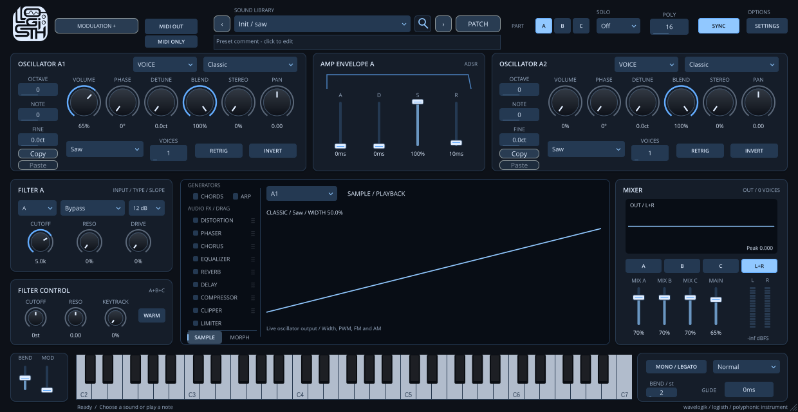

Drag the bottom-right resize handle, or open SETTINGS / DISPLAY and enter
UI SCALE from 80% to 200%. Decimal values such as 137.5% are accepted. The
nominal size is 1240 by 860 pixels expanded, or 1240 by 640 collapsed. The displayed percentage shows the last valid
scale; invalid/out-of-range entries restore it. Exact window dimensions and the
entered percentage and modulation-panel state are saved and restored when the editor or a new instance
opens. A fresh installation adapts the initial size to its display. Each open
window keeps its own size; changing one sets the default for subsequent windows.

SETTINGS uses seven categories in the central rack: DISPLAY, TEXT, COLOURS,
SKIN, MIDI and FILES, followed by ABOUT. DISPLAY contains theme selection and
window scaling; TEXT controls fonts; COLOURS edits a theme; SKIN controls its
background/knobs; MIDI contains velocity behavior; FILES shows remembered
folders; ABOUT contains credits and the logo. The standard themes are Light, Midnight Blue (default), Cobalt, Graphite,
Forest, AP always flexin'!, bokkenmmb-Solarized, bokkenmmb-Tokyo Night,
bokkenmmb-Solarized Osaka and bokkenmmb-gruvbox (ten themes). The four bokkenmmb
themes use embedded IoskeleyMonoTerm Nerd Font Mono v2.2.0, Regular and Bold,
so separate font installation is unnecessary. The AP skin uses a white geometric AP mark without
the handwritten signature, on a black/blue/cyan/violet palette. Theme selection is shared by open instances and recalled by new
ones. Appearance preferences remain independent of audio presets and projects. Theme/window preferences live in
`logisth/appearance.json` under the system user application-data directory.

DISPLAY / OPEN FOLDER reveals the current theme directory. USE FOLDER selects
another directory; missing standard themes are created there. EDIT / NEW opens
COLOURS. Enter a name and select one of twelve colour roles, then use the
colour picker or a six-digit RGB hex colour such as #62ACFF and press Enter.
DARK CONTROLS selects light/dark control styling. SAVE NEW writes a custom copy
in the current folder. SAVE AS... lets you choose a folder and exact JSON file
name. RENAME renames the selected custom theme, including its file; standard
files remain protected. RESET restores the selected saved theme.

TEXT selects a theme font family (Open Sans and Ioskeley Mono are embedded).
FONT SIZE accepts 80–125%, including typed values, independently of UI SCALE.
The reference height and last accepted percentage are displayed. FONT STYLE
selects Theme default, Regular, Bold, Italic or Bold italic. ANTIALIASING enables
smoothing; the adjacent menu selects Native (platform hinting), Grayscale,
Supersampled 2x (default) or Supersampled 4x. Off uses one-bit glyph coverage.
EDGE WEIGHT accepts 50–200%; 100% is neutral, higher values strengthen edges.
Double-click resets it. Adjusted Native edge weight uses grayscale masks.
Only glyphs change: curves/knobs retain their vector antialiasing. Text renders
at the current display scale; the interface is not resized from a text bitmap.
Size, style, quality, edge weight and AA persist globally across instances. The theme still owns its font
family. These application preferences and remembered folders are stored in
`logisth/preferences.json` under the user application-data directory.

FILES provides five independent rows: Library, Preset Load, Preset Save, Samples
and Impulses. CHOOSE... sets a directory; OPEN reveals it in the system file
browser. The selected path is displayed. Library changes the searchable preset
root; the other rows seed the corresponding file dialogs. A successful import,
load or save updates its last-used directory. Cancelled/failed operations retain
it; a deleted folder falls back to an existing ancestor.

SKIN selects Flat, Gradient, Grid, Image or Image + grid backgrounds, and
Arc/Solid/Minimal knobs. LOAD IMAGE... accepts PNG or JPEG. PNG is recommended
for sharp grids, illustrations and transparency; JPEG suits photographs.
SKIN also includes a factory-background chooser: 20 original images, two per
standard theme, with section headings naming their intended palette. Select an
image, adjust IMAGE MIX and PANELS, then use COLOURS > SAVE AS to retain it in a
portable theme. The artwork is available offline in the instrument. Choosing an
image retains your selected palette, knobs, font and AP logo.

Use 1240 x 860, or 2480 x 1720 for a higher-resolution image. Maximum input is
4096 x 4096 pixels and 16 MiB. The image is centred and cropped to fill the canvas.
IMAGE MIX sets 0–100%; PANELS sets 40–100% opacity for non-flat skins, so the
background remains visible within panels. CLEAR removes the image. The original
compressed image is embedded in the theme JSON; save with COLOURS / SAVE NEW or
SAVE AS... to make it portable. No external image file is needed on another
machine. Knob and Knob Track colours are separate from the accent. These choices preview immediately and are
saved with the theme. Unsaved edits stay with this instrument instance when its
editor closes/reopens or is minimized; save a theme to retain it across sessions.
Choosing another saved theme or RESET discards the temporary draft.

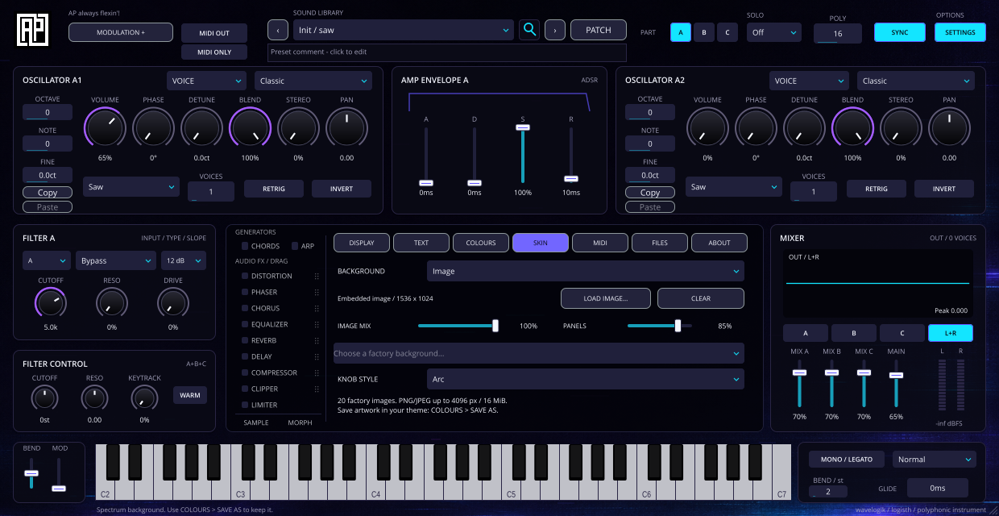

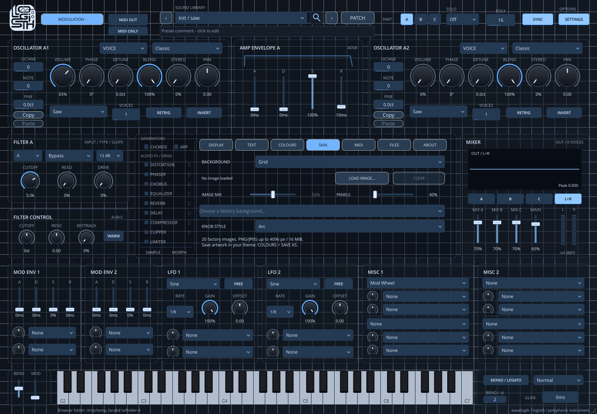

Enabled knob needles, arcs and tracks adapt their rendered contrast to their
actual surface. Light controls inside the dark screen use a dark knob face.
Arc, Solid and Minimal styles retain visible position indicators across all ten
standard themes. This rendering adjustment does not rewrite theme JSON colors.

Copy shared .json files into the selected folder to install them. The folder is
polled every two minutes; RESCAN refreshes it immediately. New files do not
change the current selection. Invalid files are ignored; removing the selected
file falls back to Midnight Blue. Version-3 themes add the embedded background
image and image/panel opacity to the name, dark flag, twelve RGB colours, font
and drawing styles. Version-1/2 themes remain readable. Use assets/themes as templates; docs/THEMES.md documents the format.

The editable comment box below SOUND LIBRARY belongs to the sound. Type a note
there, then save the user preset or DAW project. Comments support Unicode and up
to 4096 characters. Loading a preset replaces its comment; Init starts with an
empty comment. The About tab is a scrollable read-only area. Use the wheel or its scrollbar to
read the version, licenses, open-source projects and these project credits:

| Name | Contribution |
| --- | --- |
| Logik | Prompt engineer, tester, and everything in between. |
| coldwave | No. 1 tester with a head full of ideas. |
| Moander | Tester with a head full of ideas. |
| bokkenmmb | Tester, idea guy, and resident theme wizard (yes, the FoRReSkin one). |

MIDI includes **FIX MIDI VELOCITY TO MAXIMUM**. It is off by default,
retaining normal note dynamics. When enabled, every generated or played Note On
uses velocity 127, including arp output and the engine's Velocity modulation
source. It does not change MIDI note-off or other controllers. The setting is
saved with the instance's DAW state and sound presets, separately from shared
appearance preferences. Older patches and Init use normal velocity.

Drag knobs and faders to adjust values. Numeric fields can be dragged or edited.
Examples of accepted values include 2.5k for 2500 Hz, 350ms and 65%.
Double-click a control to restore its default; modulation amount controls return
to zero. Hover for a tooltip and the parameter/value readout at the bottom.
PHASE remains editable in Classic and Wavetable with RETRIG either off or on.

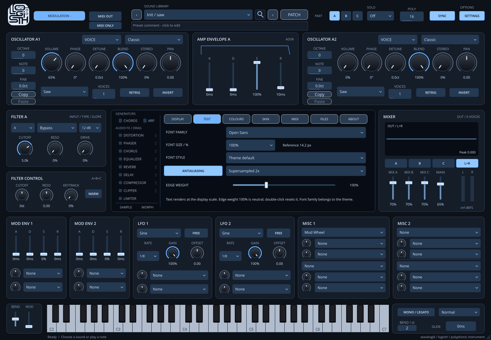

## 3. Oscillators and amplitude envelopes

There are six oscillator players: A1/A2 feed source A, B1/B2 feed source B, and C1/C2 feed source C. Select A, B or C in the header to edit its two players, filter and amplitude envelope. C starts silent in Init and older presets; raise a C player Volume to add it.
Each oscillator has a waveform menu, 0–8 unison voices, volume, octave, note,
fine tuning, phase, detune, stereo width, pan, retrigger and invert.

| Control | Purpose |
| --- | --- |
| Wave | Selects the oscillator waveform. |
| Voices | Sets the unison voice count. Zero silences this oscillator. |
| Volume | Sets its level before filtering and the part envelope. |
| Octave / Note / Fine | Coarse octave, semitone and cent tuning. |
| Phase / Retrig | Phase is a live 0–360-degree offset. Retrig gives fixed note starts; off keeps random starts while the Phase offset remains active. |
| Detune | 0–400 cents of unison spread. At 400 ct the outer voices are four semitones below/above the note. The knob midpoint is 100 ct for finer small adjustments. With one voice, detune has no effect. |
| Blend | Sets the level of additional unison voices. 100% preserves the previous unison sound; 0% retains a single tuned center. One voice is unaffected. |
| Stereo | 0% is mono; 100% fully separates left/right unison groups. The intermediate setting controls Side/Mid amplitude. |
| Pan | Positions the oscillator output left or right. |
| Invert | Inverts oscillator polarity; it can affect cancellation when sources mix. |

Detune is measured in cents: a frequency offset of c cents multiplies the note's
frequency by 2^(c/1200). The knob's nonlinear travel provides precision at low
values; typed values and host parameter values remain actual cents. BLEND uses
power compensation as added voices fade. Odd counts retain their center voice;
even counts crossfade toward an additional center stream. Its preparation is
included in the spectral memory guard. BLEND changes are smoothed and work with
all four source engines. Find DETUNE and BLEND beside each other in VOICE.

STEREO requires more than one active unison voice. A single voice, or identical
zero-detune retriggered voices, remains mono: the control does not add phase
inversion or an artificial decorrelator. With independent detuned voices, 100%
gives equal Mid/Side power and approximately zero L/R correlation. Center PAN
preserves the full width; moving PAN collapses the complete oscillator toward
that side. With BLEND at zero, the remaining single center is mono.

Small **Copy / Paste** buttons at the lower-left of every oscillator panel copy
all its controls, source envelope, FM/AM source choices, wavetable slicing and
sample audio. Paste applies them to the selected destination player. The private
clipboard is shared between open instances and does not replace the operating
system clipboard. Global modulation, filters and part envelopes are separate.
The source file is unnecessary after copying; memory limits still apply to Paste.

PHASE applies to all unison voices in the selected oscillator and can be changed
while notes are held or automated by the host. The offset is independent of
RETRIG: with RETRIG on, each new note starts at the chosen phase; with it off,
new notes keep randomized base phases and the knob offsets those phases. Toggling
RETRIG does not restart a held oscillator. Phase is relative timing, so its audible
effect is clearest when mixing periodic oscillators or moving it during a note.
Noise is nonperiodic, and Sampler/Granular use sample-position controls instead.

Live knob changes use approximately 5 ms of cyclic smoothing. Zero and 360 degrees
are equivalent; 359 to 1 degrees crosses the boundary by two degrees. Existing
phase modulation is added to the knob offset and retains its own modulation rate.

The amplitude envelope for each part has attack, decay, sustain and release.
Attack rises from silence, decay approaches sustain, and release fades after
note-off. Sustain is a level; the other three are times. The line above the
faders illustrates the current envelope. Amp Env A, B and C remain independent.
Zero-time attack and decay enter sustain without emitting
an extra peak sample. With A, D and S at zero, the note is silent. Amplitude
envelopes use a short, approximately 1 ms anti-click smoothing window, so zero
Attack/Release avoid an abrupt gate at an arbitrary waveform phase. This also
smooths other amplitude-envelope transitions and adds a bounded tail of up to
approximately 1 ms. The settled level is unchanged; modulation envelopes retain
their unsmoothed control values.
The preview uses a proportional time axis, with a 0.5-second illustrative held
segment. Zero-millisecond attack draws a vertical rise; a larger attack time
makes the rise take longer. Zero decay/release also draw vertical transitions.
There is no artificial minimum width added to these segments.

## 3.1 Four source engines

Every oscillator slot A1/A2/B1/B2/C1/C2 has its own engine menu: Classic, Wavetable,
Sampler or Granular. All six may use different engines and different audio files.
The adjacent view menu shows only pages used by the selected engine. Classic
has VOICE, ENV and MOD; Wavetable adds WAVETABLE, and Sampler adds SOURCE and
PLAYBACK. All engines have MOD, with only the applicable controls. Granular
also has GRAINS; only the Granulizer model exposes MOTION and TIME.
VOICE holds the shared tuning, level, unison, stereo and pan controls. SOURCE
holds the engine-specific controls; ENV holds that oscillator's optional ADSR.
The central Amp Env A/B/C remains the final envelope for its part.

Classic offers Sine, Saw, Pulse, Triangle, White noise, Half pulse, Quarter pulse,
Tri-saw, Pink noise, Brown noise, Organ and Folded sine. Pink and Brown have
progressively stronger low-frequency spectra. Organ adds octave harmonics;
Folded sine applies sinusoidal waveshaping. Noise has no fixed periodic phase.

MOD exposes FM INDEX (0–8 radians), FM RATIO, AM DEPTH and AM RATIO in each
player. ROUTING selects the FM and AM modulator: internal Sine or A1/A2/B1/B2/C1/C2.
A selected player supplies its pre-level signal, so reducing its audible Volume
to zero does not remove its modulation. Unison voices are averaged and modulation
signals limited to ±1. Cross-player/self-feedback uses the preceding audio sample
to keep the result independent of processing order and avoid instantaneous loops.
External-source mode does not use the internal sine ratio. FM is phase modulation
in periodic engines and a sample-read offset in sample players; noise has no
periodic carrier. Spectral sample-read changes are evaluated in 64-sample blocks.
AM is a unipolar amplitude modulator in all engines.

WIDTH / WARP, PWM DEPTH and PWM RATE are available in all engines. Pulse variants
retain conventional duty-cycle control. Other periodic Classic waves and Wavetable
compress one half of the phase cycle and expand the other; Width 50% is neutral.
Sampler/Granular warp 40 ms source-read windows. Noise uses variable-width gating:
Width/Depth determines its strength, with pitched gates in free mode and clocked
gates in synced mode. ROUTING / PWM SYNC selects musical divisions at host tempo.
The base Width and both LFO route slots remain independently addressable for
A1/A2/B1/B2/C1/C2, A, B, C, A+B, A+C, B+C and A+B+C. Live rings show the current value and recently observed
modulation range; SAMPLE shows actual player output or a warped table preview.
Manual control changes retain short smoothing ramps. Strong warping adds harmonics
and can increase aliasing; reduce depth or use a sinc interpolation mode for samples.

Wavetable treats the file as a bank of consecutive, single-cycle waves. **WT POS**
selects one frame; the selected cycle repeats at the played note's pitch. It does
not play the entire file in sequence, and adjacent frames are not blended.
Positions 0% and 100% select the first and last frames. Every frame is reachable;
a 128-frame file provides 128 selectable waves. WARP bends phase, and precomputed
spectral bands reduce aliasing at higher notes. Unison voices share one position
smoother, so adding voices does not change the speed of WT POS movement.

Click the oscillator's waveform strip to open the central source window. In
Wavetable mode, it shows a perspective stack of waves, highlights the current
frame and displays its one-based number and total frame count. While playing,
the display follows the latest voice's modulated WT position; with no active
voice it follows the knob. Drag horizontally to select a frame, or wheel one
frame at a time. The header's AUTO menu controls import cycle length. Auto reads
WAV `clm ` metadata when present, otherwise uses 2048 samples per cycle.
An untagged power-of-two file of 128–2048 samples becomes one complete cycle.
Manual lengths are 128, 256, 512, 1024, 2048 or 4096 samples; a manual choice takes
precedence over metadata. Use 4096 manually for a single 4096-sample cycle.

The factory bank contains 128 waves ranging from sine to harmonic-rich shapes.
Imported tables use the left channel, preserve cycle amplitudes, and remove DC.
Up to 256 complete cycles are extracted; trailing partial cycles are ignored,
except files shorter than one selected cycle, which are zero-padded. For ordinary
recordings use Sampler or Granular, or choose the intended cycle length manually.
Frame length and imported audio are embedded in saved presets and host state.

Sampler plays the imported audio at the selected ROOT MIDI note (default 60).
START and END choose a region; LOOP repeats it with a short crossfade; REVERSE
reverses playback. Without LOOP, playback ends at the selected boundary. Root
sets the reference pitch, not automatic pitch detection. Stereo files retain
both channels; mono files feed both channels. Unison and pitch bend still apply.

Sampler / PLAYBACK selects STRETCH, TIME FACTOR and INTERPOLATION:

| Mode | Intended material and behaviour |
| --- | --- |
| Off | Conventional pitched playback; duration follows played pitch. |
| Tape | Changes time and pitch together using the Time Factor. |
| Granular | Textured 40 ms overlapping windows, independent traversal and pitch. |
| WSOLA | 40 ms windows aligned by waveform correlation. |
| Tonal | Longer 65 ms correlation-aligned windows for sustained material. |
| Transient | Shorter 12 ms windows to localize percussive changes. |
| Kick | Original attack plus a pitch/time-shifted spectral tail. |
| Signalsmith Stretch | Upstream 1.3.2 stereo spectral processing, with native formant and tonality controls. |

TIME FACTOR ranges from 0.125× to 8×. At 2×, independent modes take twice as long
while preserving played-note pitch. Kick protects KICK ATTACK (0–100 ms, default
25 ms) at original speed/pitch, then uses an 8 ms crossfade into the processed tail.
Its total duration is attack + stretched remainder. Attack and tail are processed
independently so pitching does not smear the initial punch. Start with Kick, Time
Factor 1× and root note set to the sample's tuning for hardstyle kick pitch maps.
Try Signalsmith Stretch when the complete sound should follow pitch/time processing.

Sampler / **STRETCH** provides six independent controls for each player:

| Control | Behaviour |
| --- | --- |
| RATE | 0.125–8× traversal-speed multiplier. At Time Factor 1×, Rate 2× halves duration in independent modes; the note pitch remains controlled by MIDI and Semitones. Effective duration factor is Time Factor / Rate. |
| SEMITONES | -48 to +48 st offset, in addition to oscillator/root/MIDI pitch. Off and Tape continue to couple pitch and duration. |
| TONALITY LIMIT | 0/off to 20 kHz. Uses the upstream nonlinear frequency mapping above the chosen limit; the integration converts Hz to a fraction of the host sample rate. |
| FORMANT | -24 to +24 st shift of the spectral envelope, independent from the note offset. Zero is neutral; this does not automatically enable pitch-compensated formant preservation. |
| BLOCK (ms) | Auto, or an analysis window up to 200 ms. Spectral windows have a minimum of 32 samples. Auto uses approximately 80–93 ms at 44.1/48/96 kHz; time-domain defaults are 40 ms (Granular/WSOLA), 65 ms (Tonal) and 12 ms (Transient). |
| OVERLAP | Auto or 2–16×. Auto uses 8× for Signalsmith/Kick and 2× for time-domain windows. Greater overlap increases CPU use. |

Rate and Semitones work across sampler algorithms. Block/Overlap appear for
windowed modes; Tonality/Formant appear for Signalsmith Stretch and Kick only.
Kick applies the spectral controls to its tail while retaining the protected
original attack. Existing Time Factor values remain stored under their existing
parameter IDs. At neutral Rate/Semitones, earlier duration/pitch settings retain
their meaning. The upstream version update can change spectral voicing.

Block/Overlap changes prepare new processing pools on the control/import thread,
never in the sample callback. Playback uses the time-domain path while waiting,
then blends into the ready processor. Preparation also runs with the editor
closed, and the last requested configuration supersedes stale jobs. Muted players
rebind safely before resuming. Live Rate/tuning controls are smoothed.

Only requested sources, unison and polyphony are prepared. A conservative 512 MiB
estimate guards each spectral bank; an excessive request asks you to reduce block,
polyphony or unison. During a replacement, old and new banks can temporarily
coexist. This guard does not cover all sample/GUI memory. Larger windows and
formants increase CPU/memory use; listen to the included kick examples and your
own material before committing a track.

Interpolation choices are Linear, Cubic, Sinc 16 and Sinc 32. Sinc modes use a
windowed band-limited resampler with anti-alias filtering when reading faster
than source rate; Sinc 32 uses more CPU. Algorithm/quality switches crossfade over
20 ms. KICK ATTACK appears only for Kick mode; Granulizer controls stay separate.

In SAMPLE, wheel zoom anchors under the pointer; Shift+wheel pans. Drag to select
START/END, then drag either handle to trim. Double-click fits the selection;
right-click restores the full range. Editing is nondestructive and saved with the
sound. Granular has a separate TRIM START (also in ROUTING), independent of scanner
POSITION, so reverse grain order and LFO scanning retain their meaning. A sampler
selection uses its existing START position and END controls.

Granular offers two models. **Granulizer** is the default for new patches;
**Cloud** retains the eight Hann-windowed grains, size, density, scan and spray
controls from 0.4. Existing projects select Cloud automatically.

In Granulizer, GRAINS contains ATTACK, HOLD, GRAIN SPACE and WAVE SPACE.
ATTACK sets both fade-in and fade-out, so total grain duration is twice ATTACK
plus HOLD. GRAIN SPACE is the interval between grain starts relative to HOLD;
WAVE SPACE advances the source by HOLD times that percentage at every start.
With zero ATTACK and both spacings at 100%, playback reconstructs the sample
at its original pitch. Increasing GRAIN SPACE slows traversal without changing
pitch. WAVE SPACE can be negative: this reverses the order of grains while each
grain still reads forwards. REVERSE separately reverses each grain's samples.
Up to 64 grains overlap per unison voice; further starts are skipped if full.

MOTION contains alternating grain PAN, wave-spacing modulation DEPTH and SPEED,
RANDOM source-position variation, TIME HOLD (freezes traversal), LOOP and REVERSE.
TIME contains transient mode Off / Regions / Detect, transient HOLD, KEY TO,
TEMPO SYNC and BEATS. Regions uses imported WAV cue points; Detect uses a local
onset detector. A crossed marker aligns the grain and replaces its hold time.
KEY TO selects Pitch, Percent, Step or Transient. Pitch follows played notes;
the other modes keep source pitch and use keys relative to ROOT for position:
+12 semitones selects 50% of the sample, advances 12 holds, or selects region 12,
respectively. Negative position offsets clamp to the first position/region.
TEMPO SYNC fits traversal to BEATS at the current tempo without repitching grains.
START sets the initial location; automation moves the active scanner. LOOP wraps
over the sample to END; TIME HOLD keeps creating grains at the current location.

Click an oscillator's waveform strip or select SAMPLE in the rack for the larger
waveform view. Choose A1/A2/B1/B2/C1/C2. Drop a WAV/AIFF/FLAC onto the waveform or its
header to replace that selected slot. The slot selection is independent of the
Part A/B/C editing tab. The existing frame-size choice is used. A Classic slot
switches to Sampler after a successful import; Wavetable/Sampler/Granular retain
their mode. An invalid file keeps the previous source and mode. While dragging,
the waveform highlights the destination. Loading and waveform-peak generation
run in the background; long samples keep waveform zoom/pan responsive. It draws the actual stereo amplitude envelope,
region markers, start/end and the most recent active voice's scanner, plus up to
16 active grain positions. Click to change START; wheel zooms around the cursor;
Shift-wheel pans. The display is a view of playback, not a sample editor.

Enable OSC ENVELOPE in ENV to give a slot an additional attack, decay, sustain
and release. A part's shared envelope still limits its final output. New
WT Pos / Start A1/A2/B1/B2/C1/C2 targets individual players; A/B/C/A+B/A+C/B+C/A+B+C target groups.
These destinations scan wavetable frames or sample locations. Grain size A/B/C/A+B/A+C/B+C/A+B+C
scales grain duration. Position changes are smoothed.

IMPORT accepts WAV, AIFF and FLAC at 8–96 kHz, without a fixed duration limit.
The six imported sources share a 512 MiB decoded-stereo-PCM budget. Temporary
decoding, wavetable, waveform-cache and state-saving buffers use additional RAM.
Alternatively, drop one file onto an oscillator panel: a Classic slot switches
to Sampler, while the other engine selections are retained. Import decoding and
table preparation run on a worker, and the footer reports completion or errors.
RESET returns the slot's material to the factory glass sample/table. The waveform
strip previews the loaded material. No original media path is needed on project
recall: imported PCM data is compressed into the plug-in state, with a 1 GiB
serialized-state limit. Save larger libraries separately; this is a single-sample
source rather than a multisample instrument.

### Loop Tail

In Sampler, choose **LOOP TAIL** in that player's view menu. Enable LOOP TAIL,
set TAIL IN and TAIL OUT within the main START/END selection, and adjust
CROSSFADE (0–200 ms). Playback first traverses the complete main selection to
END. It then repeats only the tail region while the note's amplitude envelope
remains active. Note-off follows the usual release envelope. Reverse playback
traverses the full selection backward, then repeats the marked tail backward.

In SAMPLE, hold **Alt and drag** to mark the tail. Drag its lower IN/OUT handles
to adjust it; ordinary dragging still edits the main START/END range. Wheel
zoom and Shift-wheel pan remain available. Alt-right-click resets the tail to
the main selection. The loop band and playhead show its real source positions.
Each of the six players stores its own enable, points and crossfade in presets.

Enabling LOOP TAIL in the editor turns off the earlier whole-selection LOOP.
If both are enabled by host automation, LOOP TAIL takes priority. Turning it
off resumes one-shot playback from the current source position. Crossfades are
limited to a quarter of the tail's length so very short loops remain bounded;
overlapping heads shorten each repeated cycle by the crossfade duration.
Tail settings also work with sampler stretching and interpolation modes.

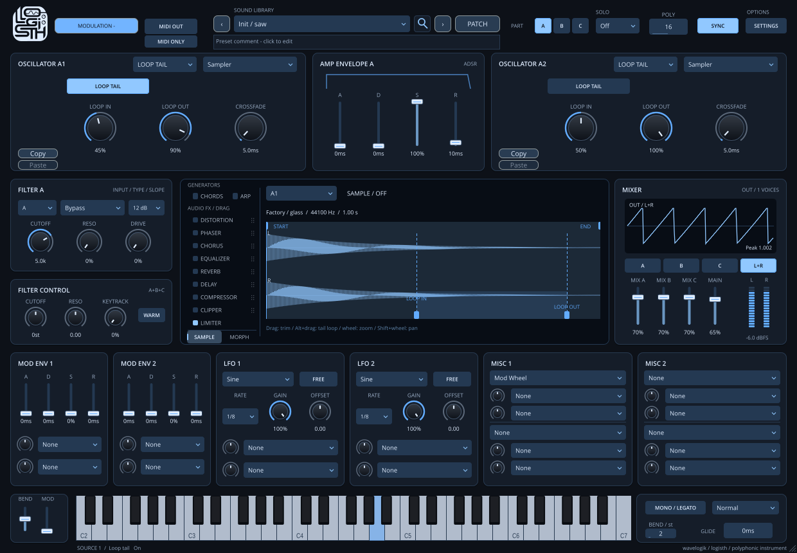

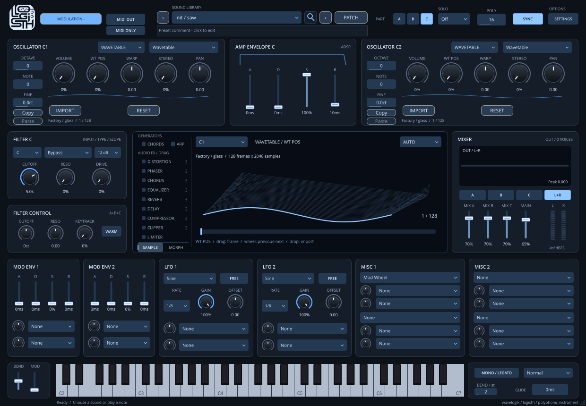

## 4. Filters and shared Filter Control

Each part has an input selector, type, slope, cutoff, resonance and drive.
Input A uses A1+A2, B uses B1+B2, and C uses C1+C2. A+B, A+C, B+C and A+B+C sum the named sources. None disconnects the input. Each of the three filters accepts all eight selections.
Consequently, a part's filter can process the other oscillator source. Its output
still passes through its own amplitude envelope and Mix level.

Choose low-pass, high-pass, band-pass or bypass. Slope selects 12 or 24 dB per
octave. Cutoff is the local frequency. Resonance emphasises the cutoff region;
high resonance can self-oscillate while a note is active. Drive adds saturation.

The shared FILTER CONTROL affects A, B and C while retaining their local
settings. CUTOFF is an offset in semitones: +12 doubles all three cutoff frequencies,
-12 halves them. RESO adds a shared resonance offset. KEYTRACK ties cutoff to
played pitch; at full tracking, an octave higher doubles cutoff. WARM changes
the filter saturation characteristic. Filter C has the same local controls as A and B.
Modulation is combined with these settings before the effective cutoff is limited
to a valid frequency for the current sample rate.

## 5. Modulation

Mod Env 1 and 2 each provide an ADSR envelope and two destination/amount pairs.
LFO 1 and 2 also provide two pairs each. Misc 1 and Misc 2 each contain two source
blocks, with two pairs per block. There are 16 routes in total. The source menu
in a Misc block chooses the signal used by both routes in that block.

Choose a destination, then move its small amount knob away from zero. Amount
ranges from -10 to +10; negative values reverse the modulation. None or amount
zero makes a route inactive. Routes to the same destination are added together.
The destination popup groups Oscillators, Filters, Mixer/effects and LFO controls,
with separate WT position/sample start, Grain size, FM, AM and Width/PWM menus.
Within a family, choose a player or scope. All shared families offer A, B, C,
A+B, A+C, B+C and A+B+C. A+C affects A and C; B+C affects B and C. The selected
field retains both the family and scope, so the route remains clear when closed.

Destinations include Volume, Pitch, Phase and Pan for A, B, C, A+B, A+C, B+C or A+B+C; Cutoff and
Resonance for A, B, C, A+B, A+C, B+C or A+B+C; Mix A, B, C, A+B, A+C, B+C or A+B+C; Phaser Frequency; LFO 1/2 Rate and
Gain; Distortion Amount; WT Pos / Start; and Grain size. Modulating A+B affects
both parts together.

Misc sources include Velocity, Keytrack, Aftertouch, Mod Wheel, Pitch Wheel,
Amp Env A/B/C, Mod Env 1/2, LFO 1/2, Step Velocity and random sources. Polyphonic
pressure takes precedence over channel pressure for the affected note. Random
values are generated at note-on. Step Velocity follows the active arp step and
returns to zero after its gate ends.

Each LFO has waveform, Rate, Gain, Offset and FREE. With SYNC enabled and FREE
off, RATE is a rhythmic division at the host tempo. With FREE enabled it uses
its Hz rate and does not restart on each note. Otherwise notes restart the LFO.
Gain scales its output; Offset shifts it. The global fallback tempo is 120 BPM
when no host tempo is available.

To modulate wavetable position, set the oscillator to Wavetable and place WT POS
near 50%. In LFO 1 or LFO 2 choose **WT Pos / Start A1**, **A2**, **B1**, **B2**, **C1**, **C2**,
**A**, **B**, **C**, **A+B**, **A+C**, **B+C** or **A+B+C**, then raise
its amount knob, for example to +5. Individual targets A1, A2, B1, B2, C1 and C2 affect
only that player. A controls A1/A2, B controls B1/B2, C controls C1/C2, A+B controls the original four, A+C combines A/C, B+C combines B/C, and A+B+C controls all six.
Individual and grouped routes can be combined; their offsets add before the
result is limited to the bank range. Both destination/amount pairs of either LFO support this route.
Set LFO Gain above zero, then choose a waveform and a free Hz rate or synced
division. Positive and negative amounts scan in opposite directions; a centred
WT POS allows a bipolar LFO to move both ways without clipping at the bank edges.
The central wavetable view follows the modulated frame; the WT POS knob retains
its base position. With Sampler or Granular this same destination modulates the
sample start/scanner position. Use a bank with multiple distinct frames to hear
wavetable scanning; a single-cycle, one-frame file has no other frame to select.

FM Index, AM Depth and Pulse Width targets each offer A1, A2, B1, B2, A, B and
A+B. Individual and grouped routes add. At amount +10 and source +1 the offsets
are +8 FM index, +1 AM depth and +1 pulse width, limited to valid ranges.
Both MOD ENV blocks start with A/D/S/R and both route amounts/destinations at
zero on a fresh instance. Set sustain or envelope times and a route to use them.

Modulation depth is specific to logisth. At amount +10 and source value +1,
pitch adds 48 semitones, cutoff adds 120 semitones, phase adds one cycle, and
pan adds one full side. Volume, Mix, Resonance, Gain and Distortion add one
linear unit. LFO Rate multiplies by 16 and Phaser Frequency by 1024. Smaller
amounts give smaller changes; start low. Effects are global, so FX modulation
uses the newest active voice. LFO feedback modulation uses the previous sample.

## 5.1 MORPH and controlled mutation

Choose MORPH in the signal rack. Rename any of the four macros by editing its
name field. Each macro has four routes: choose a target and FROM/TO percentages
of that target's host range. The knob interpolates between them; reversed ranges
are supported. Skewed targets use their normal host scaling. Routes act on the
DSP value without overwriting the target's saved base knob. If multiple routes
address the same target, the last route in macro/slot order takes precedence.
Unassigned targets keep their base value. Macro names, assignments, ranges and
amounts are stored in presets and DAW state. Target menus group sources, filters,
mixer, effects and LFO controls by function. Every source family includes
A1/A2/B1/B2/C1/C2; local cutoff, resonance and mix include A, B and C together.

MUTATE makes small random offsets to continuous timbre controls. MUTATE DEPTH
sets their size. OSC/FILTER/MOD/FX are section locks; enabled locks protect that
section. Mutation preserves imported files, engine/mode choices, MIDI timing and
main output level. UNDO restores the parameter snapshot from the last mutation;
this one-step history is temporary and is cleared when loading another sound.
Saved presets retain the section locks, but do not contain the Undo history.

## 6. Chords and pattern arpeggiator

The CHORDS rack page provides chord programming, while Pattern arp offers
independent sequence lanes.
The chain is MIDI input → Chords → Arpeggiator → Synth and optional MIDI output.
Each processor has its own enable square in the rack.

### Chord mapper

Choose CHORDS and enable its square. TRIGGER selects one of 128 MIDI notes.
VOICING assigns Unison, Major, Minor, Maj 7, Min 7, Dominant 7, Sus 2, Sus 4,
Power, Diminished or Augmented to that trigger. MAP ALL assigns the selected type
to all triggers, transposed to each root. Eight note fields edit the stored
voicing directly: drag or enter MIDI numbers 0–127; -1 removes a voice. Empty
triggers pass their original note through. Shared notes in overlapping chords
are reference-counted so releasing one trigger does not cut another chord short.

LEARN collects up to eight incoming MIDI notes for the selected trigger. Play
your voicing, then choose DONE. Notes are collected silently during learning;
DONE stores the first eight distinct pitches in ascending order. The complete
chord map is saved with the project. Chords can play as blocks with arp disabled,
or supply a pool of notes to the Pattern engine.

### Available arpeggiator modes

The engine menu contains **Legacy** and **Pattern**. The experimental Graphs mode
has been removed from the interface, audio/MIDI scheduler and host parameter list.
It cannot be enabled by an old Graphs setting. Twelve A–L pattern memories remain;
switching slots automatically retains edits. SAVE explicitly stores the selected
slot, and RAND randomizes the Pattern grid. Presets embed the entire memory bank.

MIDI OUT sends generated notes and supported pitch/controller/pressure messages
to the host. MIDI ONLY also silences synth output; turning it on enables MIDI OUT.
Route output in the DAW or choose an output device in Standalone settings.
Turning MIDI OUT off sends all-notes-off. MIDI routing depends on the host.
Large SysEx messages are not forwarded.

### Pattern engine

Choose Pattern to use the seven-row grid, with note rank, octave, velocity,
gate, repeat, chance and tie rows, independent lane lengths and two 16-step pages.
Draw or right-click for values. Existing 0.4 projects select this engine
automatically. Its pattern selector also uses the A–L memory bank. Legacy remains
a separate mode with its original controls.

### Legacy mode and compatibility

Legacy retains the ten original modes, velocity modes, 16 steps, transpose,
wrap, gate, swing, octaves and hold. The Step sequence factory sound uses it.
Older logisth states select Legacy automatically when they have no Pattern
engine parameter. ARP enable clears held notes; play fresh notes afterward.
Pattern uses note-rank/octave/gate lanes instead of Legacy transpose/wrap and
its shared gate. Legacy controls remain available in the Legacy view.

## 7. Effects rack

The default order is Distortion → Phaser → Chorus → EQ → Reverb → Delay →
Compressor → Clipper → Main → Limiter. Click a name to edit it and use the adjacent square to bypass
or enable it. All nine effects are global after the A/B/C mix.

Drag an effect's right-hand grip up or down within AUDIO FX to change its actual
audio position. The selected editor page stays open while dragging. Alternatively,
focus its row and press Alt+Up/Down, or right-click for Move up, Move down and
Reset effect order. Disabled effects retain their positions. Chords/Arp and the
Sample/Morph tools are outside this audio ordering. **Main and Limiter remain
fixed after the movable chain**, preserving the final ceiling.

The order is saved with presets and DAW state; older presets without an order
use the original sequence. Changing order while playing fades down over about
5 ms, switches at zero, then fades back over about 5 ms. This keeps one DSP state
bank and introduces no reported host latency. Effects retain their existing state
through that transition. Order is patch metadata, rather than an automation knob.
Later stages and Main can raise the level after Clipper; use the fixed output
Limiter when a final sample-peak ceiling is required.

| Section | Controls and use |
| --- | --- |
| Distortion | Four serial stages, each with its own On/Off, model, Drive and Mix. Drag headers to reorder. |
| Phaser | Six-stage stereo phasing with centre frequency, spread, L/R offset, width, LFO, feedback and Dry/Wet. Its frequency is a modulation destination. |
| Chorus | Delay, depth, rate, feedback, dual mode, width and Dry/Wet thicken a sound. |
| Equalizer | Legacy two-shelf or 16-slot Graphic/parametric; eight filter types, response curve, Auto Gain and output trim. |
| Reverb | Hall, Room, Spring, Vintage, Shimmer or Convolution; waveform/import for IR and relevant model controls. |
| Delay | Independent left/right times or divisions, feedback, ping-pong, spread, width, low/high cut, smear and Dry/Wet. |
| Compressor | Legacy/Modern, stereo link, threshold, ratio, knee, attack/release, makeup, Mix and live graphs. |
| Clipper | Hard/Soft, Drive, Ceiling, Knee, Mix and Direct/Antialiased quality, with curve and waveform. |
| Limiter | Final stereo-linked sample ceiling, release, drive, reduction history and activity. |

### Distortion and Chorus

The Distortion page contains four serial slots, in **1 / 2 / 3 / 4** order for
a new instance or Init. Click a slot header to edit its Overdrive, Foldback,
Clip, Decimate or Bitcrush model, Drive and Mix. Each slot has an ON / OFF
switch. The rack switch bypasses the entire group. Stage 1 retains earlier
Distortion controls and modulation; the three additional stages are disabled
in older patches. Host automation exposes each stage's controls separately.

Drag the headers to change their processing order, use Alt+Left/Right, or use
the header's context menu. Presets and projects store the chosen order and all
four stages. Live reordering uses a short fade around the switch. A bypassed
stage is skipped; four bypassed stages add no distortion DSP work.

Chorus keeps the same grid in Sync and free modes. RATE and DUAL share the
far-right column. FEEDBACK follows DRY/WET on the lower row; Delay, Depth,
Width and Dry/Wet keep their positions. Sync switches RATE between a musical
division and Hz without moving its cell.

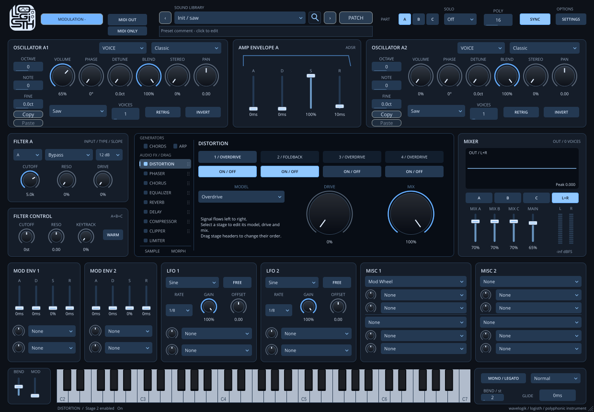

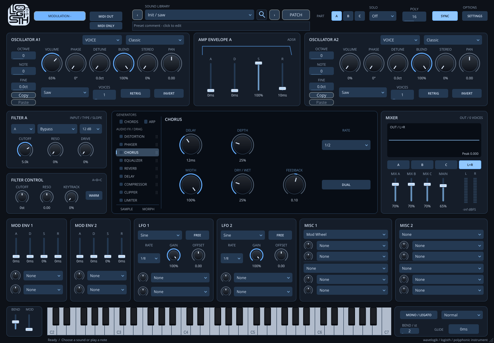

### Equalizer

MODE selects Legacy or Graphic. Legacy retains bass/treble shelves with separate
corner frequencies. Graphic opens a response plot and the selected-band inspector.
Ten enabled Bell bands initially occupy 31.5, 63, 125, 250, 500 Hz, 1, 2, 4, 8 and
16 kHz, preserving older graphic presets. Six extra slots initially remain off.

**+ BAND** enables and selects the first unused slot; **REMOVE** bypasses the
selected slot while retaining its settings. Use BAND 1–16 or click a plot point
to select a band. ENABLED toggles it independently. Up to sixteen filters may run.

| Per-band control | Operation |
| --- | --- |
| TYPE | Bell, Low shelf, High shelf, High-pass, Low-pass, Notch, Band-pass or All-pass. |
| FREQ | 20 Hz–20 kHz; actual DSP cutoff is also limited below Nyquist. |
| GAIN | ±18 dB for Bell/shelves. Other types do not use gain; its knob is disabled. |
| Q | 0.1–20, controlling resonance/bandwidth. |

Drag a point horizontally for frequency and vertically for Bell/shelf gain.
Wheel over a point changes Q. Double-click resets its gain to 0 dB. Graph axes
occupy separate margins; only the selected point is emphasized to avoid crowded
labels. The combined curve includes enabled bands, output gain and compensation.
High/low-pass are second-order filters (nominal 12 dB/octave); several slots can
be combined for steeper slopes. All-pass changes phase while preserving magnitude.

OUTPUT adds ±18 dB after either EQ. AUTO GAIN is off by default. It reduces gain
by the maximum positive response estimated across the audible spectrum. This is
peak-response compensation; later effects, resonance and several voices can
still overload. Frequency/gain/Q, enable and Legacy/Graphic changes are smoothed
around 15 ms. Filter-type changes crossfade over 20 ms; rapid requests settle to
the latest type. Both EQ modes and every band setting are saved with presets.

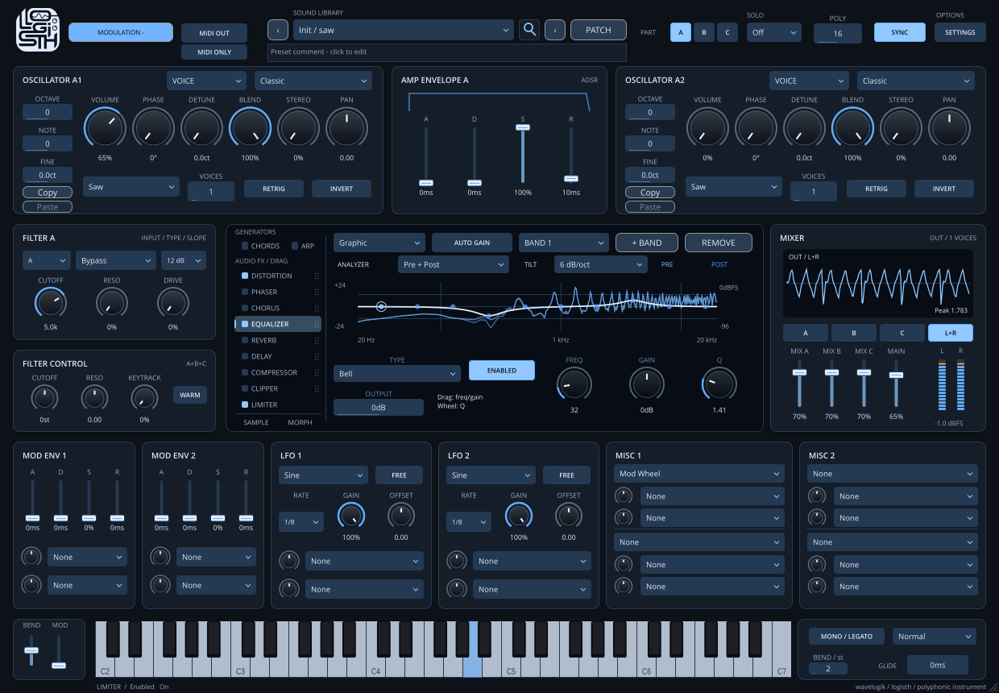

The ANALYZER selector offers Off, Pre, Post and Pre + Post. Pre captures the
actual stereo signal entering the EQ stage; Post captures its output. The
spectrum is the mean L/R power, so opposite-polarity channels remain visible.
The frequency-response curve and its band controls are separate from these
live traces. Bypassing EQ makes Pre and Post coincide.

TILT offers **0, 1.5, 3, 4.5 or 6 dB/oct**, anchored at 1 kHz. It changes the
display slope only. A 2048-sample Hann-window FFT is calculated on the GUI
thread. Off, hidden EQ pages and closed editors stop audio capture/FFT work.
Mode and tilt are application preferences rather than sound-preset parameters.

### Compressor

The compressor sits after Delay and before Clipper/Main. **MODEL** chooses
Legacy or Modern. Modern is the starting choice for new patches; presets from
before 0.9.6.2 automatically restore Legacy to retain their existing compression.
Legacy keeps the original peak-envelope detector and hard knee. Modern smooths
the gain reduction computed from a stereo-linked instantaneous peak detector.
The maximum L/R peak controls both channels, preserving the stereo image.

| Control | Operation |
| --- | --- |
| Threshold | −60 to 0 dB; the level around which compression begins. |
| Ratio | 1:1 to 100:1; reduces the amount of level increase above threshold. |
| Knee | 0–24 dB in Modern. Zero is hard; larger values spread the transition around threshold. Disabled in Legacy. |
| Attack / Release | 0.1–100 ms / 5–2000 ms. Time constants for reaching/recovering reduction, not exact time-to-completion. |
| Makeup | −24 to +24 dB after compression. |
| Mix | Parallel dry/wet mix, 0–100%. |

The left plot shows the current transfer curve, including Makeup/Mix, and
highlights the knee region. The right side shows actual input/output waveform,
peak readings and gain reduction. GR excludes Makeup. Compression permits attack
transients; use the output limiter when an exact sample ceiling is needed.

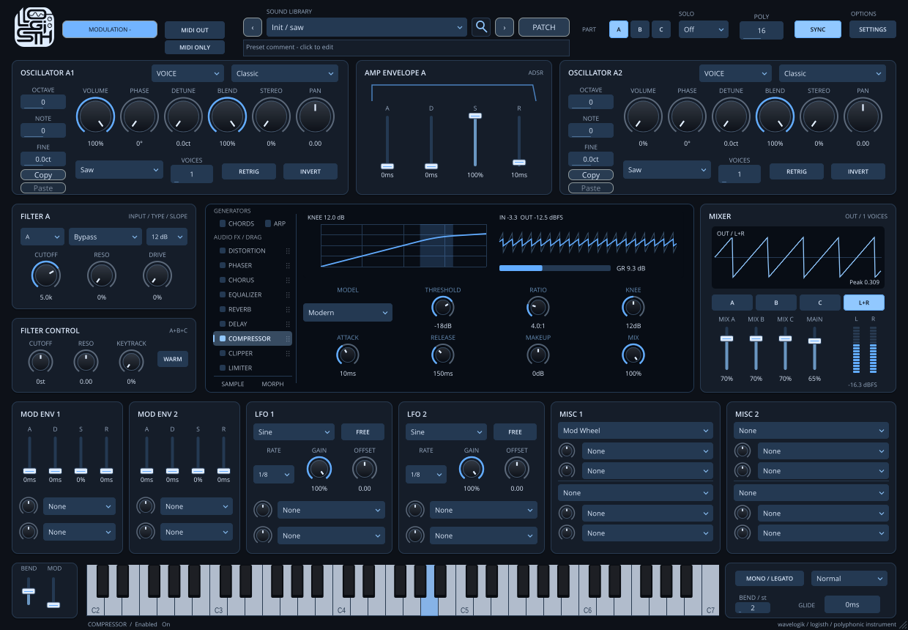

### Clipper

Clipper follows Compressor and precedes Main. **CURVE** chooses Hard or Soft.
Drive adds 0–24 dB before shaping; Ceiling sets −24 to 0 dBFS. Soft **KNEE**
controls the width of its rounded transition. At zero it becomes hard clipping.
The curve remains linear below the knee and reaches a flat ceiling above it.
Hard mode ignores Knee. **MIX** blends original dry audio with the shaped return.
At partial Mix, the dry component can exceed the clipper ceiling.

**QUALITY** chooses Direct or Antialiased. Antialiased uses first-order ADAA
with the analytic integral of the selected curve. It reduces aliasing without
oversampling buffers or added host latency; its wet path has approximately
half a sample of phase lag. Direct applies the curve to each sample. The graph
shows the static curve including Drive/Mix, while the waveform overlays actual
input and output. Enable the final limiter for a ceiling after Main.

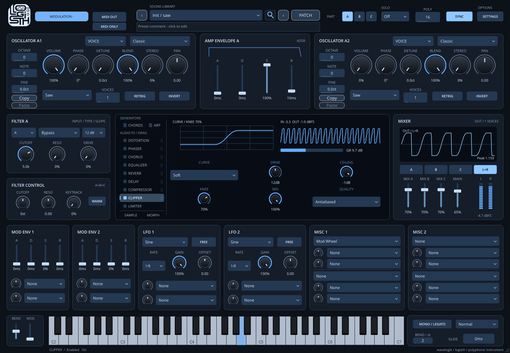

### Output limiter

Limiter is the last audio stage, after Main. Its stereo-linked instantaneous
attack prevents output samples from exceeding **CEILING** (−24 to 0 dBFS),
including during ceiling changes. **DRIVE** adds up to 24 dB before limiting;
**RELEASE** sets recovery from 5–2000 ms. It adds no lookahead or host latency.
The transfer plot, input/output peak values, reduction history and GR bar show
its activity. This is a sample-peak limiter; it does not measure intersample
true peaks. Bypass leaves the output unchanged.

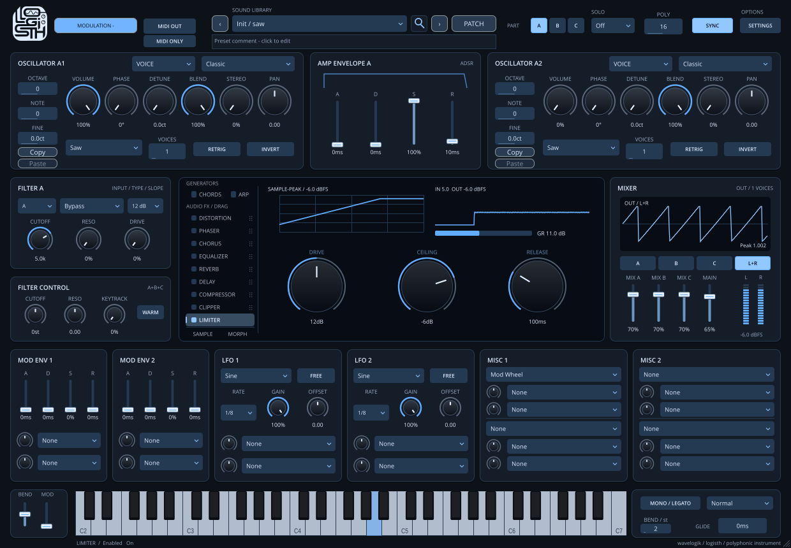

### Reverb types

TYPE selects Hall, Room, Spring, Vintage, Shimmer or Convolution. The first five use 16-line feedback delay networks
with stereo input diffusion (eight stages per channel, four for Spring). Hall
is rebuilt for a spacious diffuse tail. Room adds early reflections; Spring uses
frequency-dependent all-pass dispersion. Vintage adds dark filtering, saturated
feedback and modulated delay lengths. Shimmer uses four overlapping pitch-shift
windows in its excitation and feedback for rising/falling harmonics.

Size, Damp and Diffusion belong to the five algorithmic models. Predelay (0–200 ms), Width, Dry/Wet and Wet Gain are common to all six.
Diffusion controls the input all-pass scattering. All five modes expose Decay (0.2–20 seconds, nominal; damping changes
frequency-dependent decay). Spring adds Dispersion. Vintage adds Wow / Flutter.
Shimmer adds Shimmer amount and Pitch (-12 to +24 semitones); +12 shifts up an
octave, +7 adds a fifth and -12 shifts down an octave. Pitch-shifted tails are
intentionally diffuse. Controls irrelevant to the selected type are hidden.

Type changes crossfade over approximately 100 ms, with storage prepared before
playback. Presets and DAW state save the type and all model settings, including
those currently hidden. Main calibration is unchanged.

The five algorithmic returns are calibrated near −1 dB relative to steady pink
noise at the default Size/Damp/Decay; actual levels depend on the sound/settings.
Dry/Wet uses equal-power mixing. **Wet Gain** adds −24 to +24 dB to the return,
outside feedback, so increasing it does not destabilize the tail. Dry plus wet
can raise peak levels; adjust Mix/Main for the patch. Reverb Off clears its tail.

### Convolution and impulse responses

Select TYPE / CONVOLUTION, then **LOAD IR** to choose a mono or stereo WAV, AIFF
or FLAC impulse response. **RESET IR** restores the included synthetic chamber.
The name, channel count, sample rate, duration and preparation status appear in
the rack. A stereo waveform appears below them. Drag one WAV, AIFF or FLAC file
onto this waveform or the Convolution rack to import it. Extrema are cached during
background import rather than rescanning the PCM for every redraw. Convolution replaces the algorithmic model; irrelevant controls hide.

The engine uses JUCE's zero-latency non-uniform partitioned convolution. Mono IRs
apply the same response independently to L/R; stereo IRs use separate channel
responses. This is stereo convolution, with no four-channel true-stereo matrix. A mono
IR does not sum the input to mono: it filters both source channels independently.
A left-only source therefore remains left-only at full wet, and opposite-polarity
stereo remains opposite-polarity with an identical response on both sides.
The IR retains its original timing; leading silence is not automatically trimmed.
Predelay adds additional time. Width and Wet Gain act after the convolver.

**Normalise** defaults on: the larger channel's total squared IR energy is
normalized to one after resampling to the host rate. This preserves the stereo
channel balance and provides a useful starting level; it is not a loudness
matcher. Off retains the decoded IR's amplitude. IR preparation, resampling and
energy measurement run outside audio processing; ready replacements crossfade
over 100 ms. Loading reports errors in the footer.

Supported IR rates are 8–192 kHz. A 32 MiB decoded-stereo/resampled memory budget
limits IR size, rather than a fixed duration; a higher host rate can reduce the
maximum usable duration. Invalid, silent or oversized imports are rejected.
User IR PCM is embedded losslessly in both presets and DAW project state,
including when another reverb type is selected. Original file paths are unnecessary
on another computer. The factory response is embedded when Convolution is selected.

With Convolution enabled, the tail reported to the host includes the IR duration
plus the existing conservative 60-second instrument/effects release allowance.
A long-IR regression checks that responses over one minute are retained.

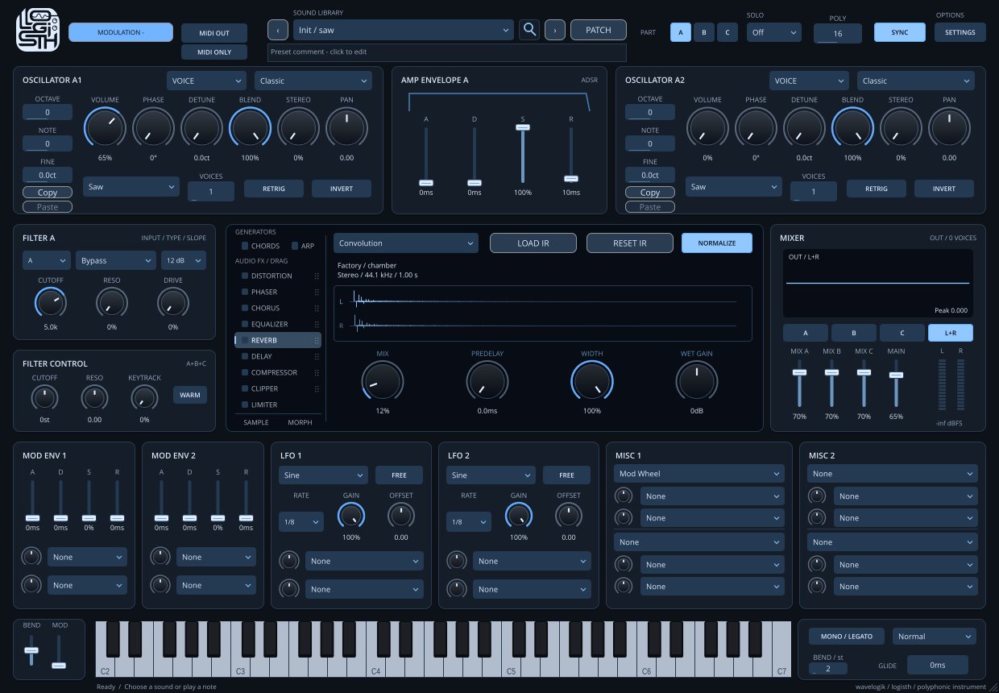

When SYNC is on, rate/time fields that support synchronization become division
menus. Turning SYNC off exposes their independent Hz/time values again. Bypass
can freeze some sections' internal memory. Reverb instead clears its tail when disabled.
Delay memory is limited to 16 seconds per channel, including very slow synced
divisions. Compressor attack/release and some effect delays use milliseconds;
envelope times use seconds internally. The panel displays suitable units.

## 8. Mixer and performance

The mixer provides A, B, C and Main level faders. Its scope has A, B, C and L+R source buttons. A/B/C show each part's stereo
sum after its filter, amplitude envelope and Mix level, before shared effects
and Solo, scaled by MAIN. L+R shows the actual final left-plus-right output,
after effects, MAIN and the final Limiter (or silence in MIDI ONLY). It is a sum, not an average. The scope uses
zero-crossing alignment and automatic visual scaling; the peak label gives the
unscaled peak. Selecting a source changes only the view and is saved in state.

### Output calibration (0.6.0)

One centred Classic sine, one unison voice, MIDI note 69 at velocity 127,
source Volume / Mix / Main at 100%, amplitude sustain at 100%, bypassed filters
and effects, and no modulation produces **0 dBFS peak on each output channel**.
The unweighted RMS is -3.0103 dBFS (a full-scale sine has RMS 1/sqrt(2)).
This is a unity reference, rather than a normal listening preset.

The source bus is calibrated before the shared FX. The previous 0.15 attenuator
and the duplicate engine Master ramp have been removed. Main is applied once,
after the movable effects and before the final Limiter. Reset starts its smoothing at the chosen Main value. Each voice's
amplitude envelope has its own approximately 1 ms anti-click edge; there is no
extra startup fade on Main. Knob changes remain smoothed. Distortion and
compressor thresholds therefore respond to the actual
source-bus level. Levels and effect drive have been retuned together; older
patches can sound different. Factory Main trims provide headroom; new instances start with Main at 65%. Reduce Main
for louder layered edits.

The test reference for the nine earlier factory presets is a six-second C3/G3/C4/E4 chord (MIDI
48/55/60/64), velocity 102, including the attack. At 48 kHz most earlier factory presets
have individual reference levels; the rebuilt Hall and corrected EQ change
some wet-preset peaks. Grain cloud and Chord pulse remain quieter. All ten
are tested at 44.1, 48 and 96 kHz. The nine authored sounds keep at least 3 dB
of reference-chord headroom; Init / saw at the requested Main 65% stays below
full scale but has less than 3 dB of headroom.
This reference does not guarantee headroom for every possible note or edit.

The mixer prints the peak of the latest processed block in dBFS. Values above
0 dBFS turn red. Constant-power panning is retained: hard panning raises the
active channel by 3.01 dB relative to centre. Two identical oscillators add
6.02 dB; eight coherent, undetuned unison voices add 9.03 dB. Keep headroom with
Mix/Main when stacking voices. There is no automatic note-count normalization
or hidden output limiter. The scope's L+R mode is a literal sum and reads +6.02
dB relative to either channel for a centred mono sine.

The release calibration ZIP includes a full-scale 440 Hz float WAV, a rendered
logisth WAV, a .logisth calibration preset and before/after CSV readings. Load
the preset, play MIDI 69 at full velocity, leave the DAW track fader at unity,
and bypass DAW effects to repeat the reference. Some RMS meters add an AES17
3 dB reference offset; these may display 0 dB RMS for this same signal.

MIX A and MIX B set the part levels; MAIN controls output after all effects.
Independent L/R meters show post-effects output. There is no hard output limiter:
loud patches, resonance and effects may exceed 0 dBFS. Reduce MAIN as needed.

POLY sets 1–32 simultaneous notes, with 16 as the default. Each note may contain
several unison voices. All four engines and prepared spectral playback support
32 notes, subject to the existing spectral workspace budget. SOLO isolates A, B or C. MONO / LEGATO uses last-note priority and returns
to the previous held note when the newest one is released. POLY is disabled in
mono mode. GLIDE sets portamento time; Normal mode glides for overlapping notes,
while Slide also permits glide between separate notes.

BEND / st sets pitch-wheel range in semitones. The on-screen BEND wheel springs
back to the centre after dragging. MOD remains where you set it. Route Mod Wheel
through a Misc block to hear its effect. MIDI pitch bend and modulation messages
also update these controls. The keyboard covers five octaves.

## 9. Presets, automation and project recall

The library contains **58 factory entries**: the clean Init / saw, the nine
previous factory sounds, and 48 new authored patches in eight categories:
Bass, Lead, Pluck, Pad, Keys, Arp, Wavetable and Sample (six new sounds each).
New patches include an editable description and four performance macros:
Brightness, Harmonics, Warp, and Space/Drive. The macros start at zero, preserving
the authored patch. The new collection is measured at full velocity with default
and maximum macro settings; output trims are per preset. The downloadable bank contains 48 native files, a short stereo demo and a measurement report. Init / saw continues to
open at Main 65%.

Click the **magnifying glass** beside the sound selector to search. Type words
from a name or category; factory descriptions and user folder names also match.
Multiple words narrow the results. Up/Down selects a row, Enter loads it, Escape
closes the panel, including when the results list has focus. Opening Settings or
PATCH also dismisses search. Clicking a row loads that result. User presets are scanned
recursively under the chosen library folder, alongside the current file.
The sound selector lists factory sounds and user presets from the library folder and its subfolders.
Its arrows step through that list. Loading replaces the current patch.

The PATCH menu provides Save as, Save current, Load file, Choose folder,
Refresh library and Delete current. Save as creates a named **.logisth** file;
Save current overwrites the active user preset. Delete asks for confirmation
and moves the file to the OS trash. The default library is logisth/Presets under
the OS application-data directory. Choose folder selects an instance's working
library, remembered as the default for later instances; it does not relocate files. Load file can open a preset from elsewhere.
Save/load run on a worker, with completion/errors in the footer. Wait for the
completion message before closing the instance or moving a newly saved file.

Successful save and load operations remember separate preset-dialog directories.
Sample import shares one remembered directory across all six players, while IR
import has its own. These paths survive editor/instance recreation. Cancelled
or failed operations retain the previous directory. If a directory was removed,
the chooser starts at its nearest existing parent. SETTINGS / FILES shows the
current locations; this is independent of the sound preset.

Presets contain all 1084 audio parameters, effect and distortion-slot order, routing, compressed audio for all six
slots, the convolution impulse response, WAV regions, chord mappings, twelve named patterns, the preset comment and
scope selection. Theme and editor size are separate user preferences and are
retained when sounds change. The original sample files are unnecessary on recall. Saving uses a
temporary file and atomic replacement. Invalid files leave the current patch
intact. State/preset files are limited to 1 GiB. These are logisth's own files;
renaming another format to .logisth does not convert it.

All 1084 parameters are available for host automation. The first 514 parameter
IDs and order from 0.4 are retained. Granulizer and global MIDI-only controls
follow them; the former Graphs parameter block is removed. A/B/C views, rack pages,
theme and scope source do not change the patch's audio settings. DAW state
contains the same embedded material and pattern data as a user preset. Restoring
older states automatically selects the corresponding earlier granular/arp engines.
Destination menus include individual and grouped WT position, FM index, AM depth
and pulse-width targets for all six players. A+B still means A and B only;
A+B+C includes C. C is also available as a Misc amplitude-envelope source,
an FM/AM modulator, a solo source and a macro target.

Version 0.9.6.1 deliberately changes the stereo mapping, reverb return levels
and Dry/Wet law. Older presets can sound different. Convolution extends the
reverb type range, and local A/B filter/mix targets extend the macro companion
ranges. The new 1055-parameter contract is frozen for subsequent releases.

C choices use companion parameters with
an ID ending in **cx**. Original chooses the saved base choice; a C extension
overrides it. The editor combines both into one menu. For host automation of a
new C option, automate its companion; set that companion to Original when
returning to an older choice. Paired A+C/B+C destinations use a second companion
ending in **cx2**, taking priority over cx. Set both companions to Original to
use the base. The editor combines all three into a single grouped menu.

Each main DETUNE knob combines the original 0–100 ct parameter, **detuneextra**
(0–100 ct) and **detunewide** (0–200 ct). Up to 100 ct uses the base; 100–200 ct
uses base 100 plus extra; 200–400 ct uses base/extra 100 plus wide. Existing
normalized automation retains its previous cents and choices. Older presets
use full blend, normal velocity, the previous ten Bell EQ bands, no added bands
and zero wide detune. States predating C retain silent C and tail loops off.

Presets use the native .logisth format. Legacy prototype states
receive a best-effort migration of filter and modulation settings; changes to
DSP mean that identical sound is not guaranteed.

## 10. Sound-design examples

For a wide lead, load Wide supersaw. Raise unison detune gradually, open shared
CUTOFF, and add a little Delay. Use MONO / LEGATO with a short GLIDE for connected
melodies. Lower MAIN if the combined voices become too loud.

For an envelope sweep, load Init / saw, lower Filter A cutoff, select Cutoff A
as Mod Env 1's first destination, and add a small positive amount. Set attack
near zero, moderate decay, low sustain and short release. Increase the amount
until the filter opens sufficiently at the start of each note.

For vibrato, choose Mod Wheel in a Misc source block and route it to LFO 1 Gain.
Set LFO 1 to a sine wave in FREE mode at a few Hz, set its base Gain to zero,
then route LFO 1 to Pitch A+B with a small amount. The wheel opens the vibrato
depth. Keep amounts low to avoid large pitch excursions.

For a sequence, load Step sequence and hold a note. Adjust PITCH and VELOCITY,
set a zero velocity for a rest, and enable HOLD to tie steps. Select 09–16 and
increase LENGTH to use the second half. Automate the shared filter cutoff to
move both parts together without replacing their local settings.

## 11. Troubleshooting and technical notes

High pitches in Sampler/Granular use interpolated resampling and may alias.
Wavetable mip bands reduce aliasing, but phase warp can introduce new harmonics.
These engines are independent implementations, not models of commercial synths.
Dense granular patches with high unison/polyphony require more CPU. Imported
material can be loud; use moderate levels. An import failure leaves the previous
material intact. A source starts again on the next note or engine/material change.

Version 0.7 rebuilds wavetable frame selection and visualization and removes the
experimental Graphs arp. Legacy, Pattern and the Granulizer remain available.
Native release archives are published only after their platform builds and tests pass.
See BUILD_INFO.json in each archive for source revision and validation results.

No sound: check the audio/MIDI device or DAW routing, oscillator Voices and
Volume, filter input, envelope sustain, Mix levels and MAIN. Check SOLO and
whether the arp needs fresh notes. A long attack or low cutoff can hide a note.

No modulation: check the source is active, destination is not None, and amount
is nonzero. The mod wheel needs an assigned route. A source can be zero during
part of a note; Step Velocity needs an active arp gate.

Missing control: A/B/C selects the part, a rack name selects effect controls, and
SYNC/FREE selects time versus rhythmic controls. PHASE works independently of RETRIG in Classic and Wavetable.
The second group of arp steps is under 09–16.

High CPU: reduce unison voices, polyphony or active effects. Some abrupt changes
to routing, waveforms and delay times can click. Selected continuous controls
are smoothed, but not every transition is crossfaded.

Disabled effects have a direct bypass. Enabled effects sleep after their output
is inaudible and their possible delayed responses have elapsed. Long IRs and
long first echoes are retained; compressor recovery and phaser/chorus LFO phases
advance during sleep. Only selected/fading reverb models are configured.
Muted oscillator players run only when needed by an audible carrier's active
FM/AM dependency chain or a possible volume modulation route. MIDI-only mode
skips audio rendering while keeping MIDI/chord/arp processing. Dynamics waveform
capture runs only for the visible page; hidden graphs do not collect samples.

Version 0.9.7 preserves the complete 1070-parameter contract from 0.9.6.2 and
appends one polyphony extension. The combined POLY control preserves the previous
1–16 automation range and adds 0–16 extra voices; old files receive zero extras.
The added dynamics stages default off in older files. Missing MODEL restores
Legacy compression; newly created patches use Modern. These changes retain preset
values while improving idle CPU behavior.

Build validation includes audio at 44.1/48/96 kHz, filters, modulation, arp timing,
state restoration, preset output and editor bindings/layout/theme persistence.
Linux tests additionally load the actual CLAP and VST3 binaries. A VST3 factory
smoke test does not replace testing in your particular DAW. Native macOS tests
run on Intel; Universal architecture checks establish that arm64 code is present,
not that it has been auditioned on Apple Silicon hardware.

The filter is an independent SVF design. The five algorithmic reverb models, including
Hall, are original wavelogik implementations. Convolution uses JUCE dsp::Convolution with an original adapter and factory IR. Signalsmith Stretch and Kick
sampler modes use Signalsmith Stretch 1.3.2 and Signalsmith Linear 0.6.6 (MIT). Modulation
scales and sequencer behaviour are defined by this manual. Open Sans and Ioskeley Mono font
notices are included in assets/fonts.

## License and manufacturer

Manufacturer: wavelogik. Product: logisth. Original code and documentation are
Copyright (c) 2026 wavelogik, licensed under MIT. Libraries, SDKs and fonts retain
their upstream licenses; see LICENSE and THIRD_PARTY_NOTICES.md. The current
plug-in identifiers use com.wavelogik.logisth and manufacturer code Wvlg. This
changes the host instrument identity from earlier builds; .logisth sound files
remain readable.
