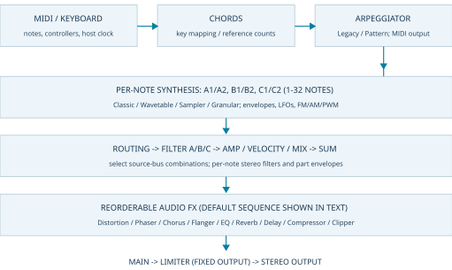

# logisth 0.9.8.1 — Technical Manual

**wavelogik · Architecture, DSP and Engineering Reference**

Document revision: 1.3 · Software baseline: 0.9.8.1 · State schema: 4

Implementation baseline: release tag `v0.9.8.1`. The technical identity manifest
records the CMake/runtime source identity. Native BUILD_INFO records its tagged
commit, tree fingerprints, binary hashes and manual identities.

This reference describes the implementation of logisth 0.9.8.1. It is
intended for sound designers, audio engineers, contributors and integrators.
The [User Manual](MANUAL.md) describes operating the interface; this document
explains how its controls affect processing, how data is stored and which
open-source components are used. Source paths and measurement reports provide
the evidence for implementation-specific statements.

Amplitude 1.0 corresponds to 0 dBFS sample peak. Frequencies are in Hz, times in
seconds unless marked ms, pitch intervals in semitones or cents, and normalized
positions in [0, 1]. Fs denotes the host sample rate. A voice is a played note;
a player is one source slot; a unison lane is one component inside a player.

## Contents

1. System specification and signal flow
2. Voice allocation and envelopes
3. Classic oscillator generation
4. Wavetable synthesis
5. Sample playback and interpolation
6. Time stretching and the spectral adapter
7. Granular synthesis
8. FM, AM and width modulation
9. Modulation matrix and performance macros
10. Filters, routing and stereo
11. Chords, arpeggiator and MIDI
12. Effect rack and reverb
13. Compressor, clipper and final limiter
14. Real-time execution and memory ownership
15. Presets, state and appearance files
16. Open-source components and licenses
17. Build, validation and release engineering
18. Measurements, limits and source index

## 1. System specification and signal flow

| Property | Implementation |
| --- | --- |
| Product / producer | logisth / wavelogik |
| Implementation language | C++17; CMake 3.22 or newer |
| Host formats | VST3, CLAP, Standalone |
| Audio buses | No audio input; one stereo output |
| Audio processing | 32-bit floating-point sample buffers; selected calculations/state use double precision |
| Parts / players | Three parts A/B/C; two players per part: A1/A2, B1/B2, C1/C2 |
| Player engines | Classic, Wavetable, Sampler, Granular |
| Note polyphony | 1–32 voices, default 16; mono/legato and portamento available |
| Unison selection | 0–8 lanes per player; 0 disables the player |
| Host parameter count | 1084; previous 1071 definitions retained, thirteen distortion controls appended |
| Modulators | Two modulation ADSRs, two LFOs, four miscellaneous source selectors, two destinations per modulator |
| Performance macros | Four macros, four target assignments each |
| Pattern memory | Twelve pattern slots; sequences up to 32 steps |
| Sound library | 58 factory entries, including Init and 48 separately packaged authored presets |



MIDI first passes through chord mapping and the arpeggiator. The processor renders
audio up to each generated event offset before applying that event. Within each
note, the six players form three source buses. Each part filter can select any
combination of those buses. Its amp envelope, velocity and part mix scale the
filtered signal. Solo determines which part contributions reach the common sum.

The default stereo audio order is **Distortion → Phaser → Chorus → Equalizer →
Reverb → Delay → Compressor → Clipper → Main → Limiter → Output**. The eight
pre-Main stages are user-reorderable. Chords and Arpeggiator occupy a separate
GENERATORS row; Sample and Morph remain editing/performance tools. A new editor
opens Sample. Main and the final Limiter are fixed at the output.

The order is a validated permutation of eight stage IDs, packed into one atomic
24-bit value. Each source callback uses one prepared effects state bank. A live
change fades down for 5 ms, switches order at zero and fades up for 5 ms. Chunk
boundaries also respect this transition. It does not run two parallel effect
banks, allocate new DSP state or add reported host latency. The current order
travels with presets and DAW state; absent legacy metadata selects the original
sequence. Drag, Alt+Up/Down and the context menu share the same ordering API.

Host buffers are processed in chunks of at most 512 frames, further divided at
MIDI events. The chunk size is an internal work bound, not an extra block of
reported latency. The output limiter and convolution adapter add no host latency.
Envelope edge smoothing and spectral windowing have their own response times,
described below. The instrument exposes one host program; its richer preset
browser is maintained inside the plug-in.

The host tail query reports a conservative 60 seconds, plus IR duration when
Convolution is enabled. This is a host rendering allowance, not a promise that
every patch produces a 60-second audible decay.

Implementation: [PluginProcessor.cpp](../Source/PluginProcessor.cpp),
[PluginProcessor.h](../Source/PluginProcessor.h), [Topology.h](../Source/Topology.h).

## 2. Voice allocation and envelopes

The engine preallocates thirty-two voice records and defaults to a sixteen-note limit. Polyphonic allocation selects an
inactive voice first and otherwise steals the oldest voice within the active
limit. A voice contains phase, unison, noise, sample, filter and modulation state
for all six players. The inner rendering loop visits only the configured voice range. The sixteen
MIDI channels retain separate pitch wheel, mod wheel,
pressure and sustain state. Mono legato uses the held-key history and portamento
logic instead of allocating a new independent note for every key.

Every part has its own amplitude ADSR. Every player also has an optional source
ADSR. Two additional ADSRs are dedicated to modulation. Logical stages are
piecewise linear: Attack rises to one, Decay falls to Sustain, Sustain holds its
level, and Release descends from the current value. A zero-duration stage is
traversed immediately. With A=D=S=0, the envelope enters silent sustain without
emitting a one-sample peak. Mod Env 1 and 2 initialize with all values zero.

Audio envelopes apply two approximately half-millisecond moving averages and
a one-sample causal delay. Their positive triangular kernel has unity DC gain
and a finite, approximately 1 ms settling tail. This softens zero-time amplitude
edges without overshoot. Modulation envelopes retain their exact logical stage
values. An amplitude envelope can remain active briefly after the logical release
ends so its finite smoothing tail reaches exact silence.

PHASE is a live cyclic offset, smoothed over approximately 5 ms using the shortest
wrap-around direction. RETRIG controls note-start phase policy independently;
turning PHASE continues to work with RETRIG off. INVERT reverses signal polarity.
Changing source engine resets that player's playback state. Init is a plain saw
starting patch with Main at 0.65 linear amplitude; at a settled Main value this
corresponds to approximately −3.74 dB relative to unity.

Implementation: [Envelope.h](../Source/Envelope.h), [Engine.h](../Source/Engine.h).

## 3. Classic oscillator generation

Classic waves are generated mathematically at runtime. They are not recordings.
The oscillator maintains a phase accumulator, wraps it into [0, 1), and evaluates
the selected waveform. The phase increment is capped at 0.45 cycles/sample.

| Wave | Generation method |
| --- | --- |
| Sine | sin(2π phase) |
| Saw | Linear ramp with a polynomial band-limited step correction, polyBLEP |
| Pulse | Two-level duty wave with polyBLEP corrections at both edges |
| Triangle | Piecewise linear triangle |
| White noise | Bipolar xorshift32 pseudorandom sequence |
| Half / Quarter pulse | Pulse duty scaled by one half / one quarter |
| Tri-saw | Equal blend of saw and triangle, with the saw discontinuity corrected |
| Pink noise | White noise through a fixed multi-state recursive coloration network |
| Brown noise | Leaky integration of white noise |
| Organ | Weighted sum of the fundamental, second and fourth harmonics |
| Folded sine | sin(3 sin(2π phase)) |

PolyBLEP corrects selected discontinuities. This implementation does not apply
global oversampling or guarantee alias-free output under arbitrary FM, phase
distortion or high-frequency nonlinear processing. The noise generator uses
repeatable internal seeds; noise playback is procedural rather than file based.

For lane spread s in [−1, 1], tuning is:

```text
frequency = 440 * 2^((note - 69 + bend + modulation + tuning + s*detune/100)/12)
```

The detune display spans 0–400 cents with 100 cents at its midpoint. The DSP sums
three preserved host parameters: base 0–100, extension 0–100 and wide 0–200 cents.
At 400 cents the two outer lanes are −400 and +400 cents from the tuned center.
The total outer-to-outer interval is therefore 800 cents, not 400.

BLEND scales the additional unison lanes while retaining a tuned center at zero.
For an even lane count, a prepared extra center lane participates while needed
for that blend; internal capacity is nine lanes although the selector ends at
eight. Gain is normalized by the square root of the sum of squared lane weights.
This controls energy across the blend rather than guaranteeing identical peaks
for correlated phases. A player needed as an active FM/AM source can still render
when its audible level is zero.

Implementation: [Engine.h](../Source/Engine.h), [Parameters.h](../Source/Parameters.h).

## 4. Wavetable synthesis

Wavetable mode interprets audio as consecutive complete periodic cycles. A frame
is one cycle, not an individual PCM sample. A 128-frame table with 2048 points
per frame contains 262144 PCM points. WT POS chooses a frame; oscillator phase
travels around that frame while note pitch determines its repetition rate.

Frame sizes are powers of two from 128 to 4096 points. Import accepts an explicit
frame size or reads a supported RIFF `clm ` cycle-length hint. Without a hint,
a valid power-of-two file of at most 2048 points becomes one frame; other files
default to 2048 points/frame. Up to 256 frames are used. Complete frames beyond
that cap and the incomplete trailing remainder are not added to the frame set;
a file shorter than one selected frame is zero-padded into one frame.

An original radix-2 FFT builds eleven harmonic-limited table levels off the audio
thread. The DC bin is removed and progressively higher harmonics are discarded.
Playback linearly interpolates points within the cycle and blends neighboring
spectral levels according to phase increment. Tables use the first decoded audio
channel and are played as a mono periodic source before unison/panning.

Frame selection is explicitly discrete:

```text
frame = round(clamp(WT_POS, 0, 1) * (frame_count - 1))
```

There is no interpolation between adjacent frames in this version. WT POS is
smoothed over approximately 10 ms before selection, but movement can still
produce discrete frame changes. Individual player destinations and A/B/C,
A+B, A+C, B+C and A+B+C scopes allow independent or grouped position modulation.
The display reports the selected frame position. WARP applies a sinusoidal phase
offset; WIDTH applies the phase remapping described in section 8.

Implementation: [SourceData.h](../Source/SourceData.h),
[SourceAssets.cpp](../Source/SourceAssets.cpp), [Engine.h](../Source/Engine.h).

## 5. Sample playback and interpolation

Sampler mode reads decoded stereo floating-point PCM between normalized START
and END points. Root key, note tuning, reverse, looping, source envelope and
sample-rate conversion affect its read cursor. Mono imports are duplicated to
both channels. File decoding, transient analysis and waveform peak generation
run outside the audio callback. The interface accepts WAV, AIFF and FLAC.

| Interpolation | Method and cost |
| --- | --- |
| Linear | Two adjacent samples; lowest cost |
| Cubic | Four-point cubic interpolation |
| Sinc 16 | Sixteen-tap Blackman-windowed sinc |
| Sinc 32 | Thirty-two-tap Blackman-windowed sinc |

Sinc cutoff is reduced when playback speed exceeds unity. These kernels provide
a quality/cost choice; their finite length is not an ideal reconstruction filter.
Boundary reads respect the chosen selection and looping behavior.

Whole-selection loops blend across a short end region, normally up to 5 ms and
at most one quarter of the selection. **Loop Tail** first plays the complete
selection once, then wraps between separate tail IN/OUT points. Its adjustable
crossfade is bounded by one quarter of that loop. Tail bounds remain within the
selection and are mapped for reverse playback. They are saved as parameters.

There is no fixed duration cap. The combined imported PCM budget across six
source slots is 512 MiB, counting stereo 32-bit PCM at eight bytes/frame. This
is approximately 23.3 minutes of one stereo 48 kHz source if no other imported
source occupies the budget. It excludes derived wavetable levels, peak caches,
decoder temporaries and spectral workspaces, so total process memory can be
considerably higher. Source files must be 8–96 kHz, contain at least two frames
and finite samples. Imported amplitudes are bounded to [−8, 8].

Implementation: [Sampler.h](../Source/Sampler.h), [SourceAssets.cpp](../Source/SourceAssets.cpp),
[AssetLimits.h](../Source/AssetLimits.h).

## 6. Time stretching and the spectral adapter

| Algorithm | Processing behavior |
| --- | --- |
| Off | Ordinary pitched resampling; Rate changes playback speed |
| Tape | Resampling with the time factor applied to cursor speed; time and pitch remain linked |
| Granular | Overlapping Hann-windowed sample segments |
| WSOLA | Waveform-similarity overlap-add, aligning windows with a normalized correlation search |
| Tonal | WSOLA-family path with a longer automatic window, 65 ms |
| Transient | WSOLA-family path with a shorter automatic window, 12 ms |
| Kick | Original attack/tail hybrid using direct attack playback and a Signalsmith-processed tail |
| Signalsmith Stretch | Upstream spectral time/pitch processor through the prepared streaming adapter |

Granular/WSOLA use a 40 ms automatic window and twofold overlap unless another
window/overlap is selected. WSOLA correlation examines 32 points, first searches
coarsely within a bounded range and then refines around the best shift. Stereo
channels share the chosen alignment. Tonal and Transient are settings of this
implementation, not separate third-party libraries or guaranteed source-separation
models. The overlapping sampler has sixteen fixed grain records per lane.

The effective time factor is Time Factor divided by Rate, with internal safety
bounds of 1/64–64. Rate spans 0.125–8 and Semitones spans −48–48. Rate, pitch,
tonality and formant changes are smoothed over approximately 20 ms. Shared
controls are applied only where the selected algorithm supports them:

| Control | Effect |
| --- | --- |
| Rate | Changes source traversal/time factor; Off and Tape retain linked resampling behavior |
| Semitones | Additional pitch ratio 2^(semitones/12) |
| Tonality Limit | Passed to the spectral processor as Hz/Fs; zero selects its unrestricted/default behavior |
| Formant | Spectral formant shift, −24–24 semitones |
| Block (ms) | Custom analysis/overlap window; zero selects the algorithm's automatic window |
| Overlap | Auto or ratios 2–16; controls hop size relative to the window |

The Signalsmith adapter configures two channels and produces 64 output samples
at a time, retaining a fractional input-count remainder. Automatic spectral
window size is the first power of two at least 80 ms long; automatic hop size is
window/8. A nonzero Block setting produces at least 32 window samples and a hop
of at least one sample. Transpose factor is bounded internally to 1/256–256.
Tonality and formant are passed directly to the upstream APIs after validation.

At note start or source revision changes, the adapter resets/seeks the processor
and offsets its input cursor using the upstream input/output latency values.
This is sample-instrument alignment, not an advertised general-purpose
zero-latency live input stretcher. Windowing and transient behavior remain
algorithm dependent. Window, overlap, sample-rate and capacity changes require
new prepared streams; they are not allocated in the audio callback.

Kick retains a configurable direct attack of 0–100 ms, then crossfades over 8 ms
into its pitched/stretched tail. When a matching prepared spectral stream becomes
available, existing playback can crossfade to it over 20 ms. A bounded overlap-add
path is available while preparation is pending. Kick is original adapter logic;
the spectral tail processor is the unmodified Signalsmith dependency.

Spectral banks have a separate 512 MiB estimated workspace budget. The estimate
includes selected players, note capacity, unison capacity and two prepared lanes
per cell. This bound does not mean all six players at maximum unison/polyphony
can always use every window size. Unsupported memory configurations are rejected
instead of allocating without a bound.

Implementation: [Sampler.h](../Source/Sampler.h), [Spectral.h](../Source/Spectral.h),
[SourceAssets.cpp](../Source/SourceAssets.cpp).

## 7. Granular synthesis

The dedicated Granulizer uses sixty-four fixed grain records per player/unison
lane. A grain has a source cursor, age, attack, hold and alternating stereo pan.
Its envelope has linear attack and release around a flat hold. Spawn interval is
Hold multiplied by Grain Spacing, bounded to at least one sample; grain attack
does not add to this scheduling interval.

Wave Spacing controls how far the scanner advances between launches. Negative
values move backward. Freeze stops scanner advancement while existing/new grains
continue playing. Randomness perturbs launch position within the selection.
An internal sine LFO can modulate spacing; Sync relates scanner traversal to
sample beats and host tempo. Reverse changes each grain's read direction.

Key To can address pitch, start position, grain positions or region/transient
indices. Region markers come from imported cue points. Automatic transient
markers use a simple 64-sample peak-rise detector with a minimum 12 ms separation;
this is not a learned onset classifier. Transient modes can snap launches to
markers and substitute a dedicated hold duration.

The output uses fixed overlap compensation derived from attack, hold and spawn
interval. It avoids a continuously varying active-grain gain controller. If all
records are occupied, a launch cannot create another grain. The older granular
source path remains available through its model selection and has its own
behavior; the dedicated model and sampler's Granular stretch mode are distinct.
Waveform cursors and displayed grain markers are telemetry from the newest
active voice, not a complete plot of every polyphonic grain.

Implementation: [Granular.h](../Source/Granular.h), [SourceData.h](../Source/SourceData.h).

## 8. FM, AM and width modulation

Every player has an internal sine modulator or can select another player as
its FM/AM source. External source signals are bounded to [−1, 1] and read from
the previous sample. This makes circular routes causal and avoids solving an
instantaneous feedback loop. Dependency analysis keeps required muted sources
running. Source level, source envelope and output panning do not simply act as
the external modulator's gain: the modulation tap is taken from the player's
weighted source signal before its audible output gain.

The control labeled FM is implemented as phase modulation:

```text
phase_offset_cycles = FM_index * modulator / (2*pi)
AM_gain = 1 - AM_depth * (1 - clamp(modulator, -1, 1))/2
```

FM index spans 0–8. AM depth spans 0–1 and is unipolar amplitude modulation, not
bipolar ring modulation. Internal ratio controls set the sine modulator rate
relative to the carrier; when another player is selected, that source has its
own tuning. Sample modes translate phase modulation into a read-position offset.

WIDTH/PWM applies to every source type. Duty is bounded to 0.01–0.99. For periodic
non-pulse waves and wavetable frames, phase is remapped in two linear segments:

```text
phase < width:  mapped_phase = 0.5 * phase / width
otherwise:      mapped_phase = 0.5 + 0.5*(phase-width)/(1-width)
```

At width 0.5 this is the identity. Pulse waves move their actual duty edges.
Noise uses a softened duty gate. Sampler/granular modes warp local 40 ms read
windows. These are source-appropriate width effects rather than identical
spectral operations. PWM adds a sine offset to width, optionally tempo synced.
FM/AM/width targets can address a single player, a part or part combinations.

Implementation: [PhaseWidth.h](../Source/PhaseWidth.h), [Engine.h](../Source/Engine.h).

## 9. Modulation matrix and performance macros

Two modulation envelopes and two LFOs each have two destination/amount routes.
Four miscellaneous selectors provide two more routes each: sixteen matrix
routes in total. Sources include velocity, key tracking, channel/poly pressure,
mod wheel, pitch wheel, part amp envelopes, both modulation envelopes/LFOs,
step velocity and unipolar/bipolar per-note random values.

LFO shapes include sine, triangle, saw, ramp, square, quarter pulse, sample-and-hold,
smooth random and positive sine/triangle variants. Free LFOs retain common clock
phase between notes; other LFOs use voice-local state. Synced rates use musical
divisions; free rates use Hz. LFO rate/gain feedback destinations use the previous
sample's modulation values. Internal effective rate is bounded to 0.001–200 Hz.

A route adds source multiplied by Amount/10. Targets then apply their own unit
scaling and limits. For example, pitch uses 48 semitones per normalized unit,
filter cutoff uses 120 semitones, and FM uses eight index units. Individual and
group destinations add together. A+B affects only A and B; C and A+C/B+C/A+B+C
are explicit scopes. WT POS is independently addressable for all six players.

Effect modulation is monophonic: distortion amount and phaser frequency use the
newest active voice's modulation value. It is not six independent effect racks.
Four Morph macros each assign up to four From/To target ranges. Macro application
maps normalized values through the destination's parameter skew; if multiple
macro routes overwrite the same parameter, later evaluated assignments win.
Mutate operates on eligible targets with category locks and one-step undo.
Macro names, routes and locks are stored with the patch.

Implementation: [Modulation.h](../Source/Modulation.h), [Morph.h](../Source/Morph.h),
[PluginProcessor.cpp](../Source/PluginProcessor.cpp).

## 10. Filters, routing and stereo

Each part selects A, B, A+B, None, C, A+C, B+C or A+B+C as its filter input. The
three stereo filters are per note, not just one global effect on the completed
mix. Each provides low-pass, high-pass, band-pass or bypass; the 24 dB selection
cascades two two-pole stages, while 12 dB uses one.

The filter is a topology-preserving state-variable design. Its frequency
coefficient is tan(π cutoff/Fs). Drive scales input by 1+12*Drive and applies
saturation; Warm chooses tanh instead of x/(1+abs(x)). State saturation also
limits the high-resonance condition. The effective cutoff law is:

```text
offset = global_cutoff + 120*matrix_cutoff + (note-60)*keytrack
cutoff = clamp(local_cutoff * 2^(clamp(offset,-180,180)/12), 20, 0.43*Fs)
resonance = clamp(local_resonance + global_resonance + matrix_resonance, 0, 1)
```

Global FILTER CONTROL therefore offsets all three local filters while retaining
their relative settings. Cutoff is smoothed over approximately 10 ms.

Unison Stereo spreads noncentral lane groups with separation 2w/(1+w²), where
w is the 0–1 Stereo value. Full width sends left and right groups exclusively
to their respective channels; a center lane stays centered. Pan shifts the
complete group, so full Pan reaches the selected side. Equal-power gains are
sqrt((1-pan)/2) and sqrt((1+pan)/2). The engine's final sqrt(2) calibration gives
unity per channel for one centered full-scale mono source at unity output settings.
No note-count-dependent automatic gain controller is applied.

The sum scope displays L+R, not (L+R)/2. Part A/B/C traces are pre-effect part
contributions with Main and live-order transition scaling; the sum is the final post-limiter stereo sum.
Do not interpret part traces as isolated post-effect stems. The separate player
scopes are pre-filter traces. Stereo measurements are in the report linked in
section 18; width does not guarantee a fixed correlation for every source/phase.

Implementation: [Engine.h](../Source/Engine.h), [Stereo.h](../Source/Stereo.h),
[Gain.h](../Source/Gain.h), [PluginProcessor.cpp](../Source/PluginProcessor.cpp).

## 11. Chords, arpeggiator and MIDI

Chord mapping contains 128 key assignments with up to eight output notes each.
Overlapping held chords use note reference counts, so releasing one trigger
does not stop a note still owned by another trigger. Built-in chord types and
learned mappings can be edited and stored in the patch.

The Legacy arpeggiator supplies ordered, alternating, random, played-order,
step and chord behavior. Pattern uses independently sized Note, Octave, Velocity,
Gate/Tie, Repeat and Chance lanes, each up to 32 steps. Repeats subdivide a step
up to four times. Gate is relative to the resulting repeat interval. Chance
uses the engine's repeatable pseudorandom generator. Swing alternates long/short
step durations. Latch, sustain and transport changes affect retained notes;
disable/reset paths emit the appropriate releases. Graphs mode is not exposed.

With Sync, step duration follows tempo and division; otherwise it follows a
time value. Host transport position informs stop/seek handling. Generated MIDI
can be routed to the host. Actual availability of an instrument's MIDI output
depends on host routing support. MIDI-only mode retains chord/arp/controller
processing but skips synth audio and effect rendering. Switching modes clears
existing voices/effect state so hidden audio voices do not accumulate.

Fixed MIDI Velocity, off by default, forces Note On velocity to one for synthesis
and generated MIDI. It is patch/instance state, not an appearance-only setting.
Incoming MIDI is handled with sample offsets; parameter snapshots are collected
per process call, so this does not assert sample-accurate host automation of
every parameter.

Implementation: [Chords.h](../Source/Chords.h), [Arpeggiator.h](../Source/Arpeggiator.h),
[ArpTypes.h](../Source/ArpTypes.h).

## 12. Effect rack and reverb

| Stage | Implementation |
| --- | --- |
| Distortion | Four independently enabled serial stages: tanh, folding, hard clipping, sample hold or quantization; per-stage Drive/Mix smoothing |
| Phaser | Six all-pass stages per channel, LFO frequency sweep, feedback and width |
| Chorus | Fractional delay modulation with stereo phase offsets; optional dual lines and feedback |
| Legacy EQ | Two corrected second-order shelving filters: bass and treble |
| Graphic EQ | Sixteen independent biquad slots with frequency, gain, Q, type and enable |
| Reverb | Five original algorithmic models or prepared JUCE convolution |
| Delay | Stereo fractional delay, separate L/R times/divisions, feedback filtering, smear, ping-pong and width |

Distortion slot 1 retains the original Type/Drive/Mix and its modulation target.
`dist1on` defaults on; the group master retains its existing bypass behavior.
Three further slots each append On/Type/Drive/Mix, default disabled. DistortionOrder
is a validated 8-bit permutation of four identities. Factory Init uses 1/2/3/4.
Presets/projects save it as optional `distortionOrder` metadata; missing metadata
uses the original order. Invalid metadata rejects the patch before publication.
Each stage owns independent hold counters, stereo memory and smoothing. The
selected order drives actual serial processing. Reordering uses the same 5 ms
down/switch/5 ms up policy as the outer rack, without duplicate banks. Disabled
or zero-Mix stages are skipped; all-disabled groups bypass without distortion work.

The EQ analyzer taps full-rate L/R immediately before and after its current
position in the movable effects rack, including bypassed EQ. Four atomic ring
lanes carry pre-L/pre-R/post-L/post-R. Audio only copies samples; a GUI-side
2048-point radix-2 FFT applies a periodic Hann window. One-sided amplitudes are
normalized by the window sum (DC/Nyquist have no doubling). The trace averages
L/R power before 10 log10, avoiding antiphase cancellation. A bin-centered
full-scale stereo sine is 0 dBFS; doubling it gives +6.0206 dB. Attack/release
smoothing is visual. Display tilt is `1.5 * choice * log2(f/1000)`, choice 0–4.
It does not alter audio coefficients. Off or a hidden/closed EQ view disables
capture and FFT work. The response curve remains available with the analyzer off.

Graphic EQ types are Bell, Low shelf, High shelf, High-pass, Low-pass, Notch,
Band-pass and All-pass. Frequency spans 20–20000 Hz, gain −18–18 dB and Q 0.1–20;
coefficients additionally respect the host's Nyquist region. Ten slots start
enabled and six are available to add. Gain/frequency/Q smoothing uses about
15 ms; type changes crossfade over about 20 ms. The graph evaluates the same
coefficient model used by processing. Auto Gain estimates the largest boost
over 96 log-spaced frequencies and compensates it; it is not a loudness meter
or an LUFS normalization process.

The algorithmic reverb family uses sixteen delay lines with an orthogonal
Householder feedback transform, stereo injection/output signs, input diffusion,
damping and DC control. Size changes line lengths; Decay derives feedback gains
from a nominal 60 dB decay target. Decay spans 0.2–20 seconds. Character controls
and nonlinear behavior can change the measured decay envelope.

| Model | Distinguishing processing |
| --- | --- |
| Hall | Longer feedback delays and subtle delay modulation |
| Room | Shorter delays with explicit stereo early-reflection taps |
| Spring | Additional dispersive all-pass stages in the feedback paths |
| Vintage | Modulated delays, restricted high-frequency response and feedback saturation |
| Shimmer | Windowed pitch-shifted feedback injection; pitch −12–24 semitones |
| Convolution | Stereo partitioned FIR driven by an imported or factory impulse response |

These five characters share an original network design. Spring is a dispersive
digital model, not a physical mechanical simulation. Reverb Dry/Wet uses an
equal-power cosine/sine crossfade; Wet Gain supplies −24–24 dB. Model changes
crossfade, running the old and new engines while required. Turning Reverb off
clears its tail.

Convolution uses JUCE `dsp::Convolution::NonUniform{256}`, prepared for stereo,
512-frame work chunks and zero added latency. Mono IRs are duplicated; stereo
IRs apply left-to-left and right-to-right convolution, not four-channel true
stereo cross-convolution. Trimming and JUCE's built-in normalization are disabled.
The logisth Normalise option measures the actual prepared/resampled response and
uses 1/sqrt(max(left_energy,right_energy)), capped at 1e6. It is energy
normalization rather than peak normalization. Gain changes are smoothed.

The stereo review decodes real WAV fixtures and compares the complete reverb
stage against direct L/R FIR reference convolution: 48 cases combine three rates,
mono/asymmetric-stereo IRs, independent/left-only/right-only/antiphase inputs and
normalization on/off. Two further cases render the actual sampler through IR
and Main. The recorded maximum sample error is approximately 1.04e-7; the guard
threshold is 2e-5. C++ allocation guards cover audio processing. This validates
lane mapping, polarity, shared normalization and default Width=1, Predelay=0;
it is not an acoustic quality comparison for arbitrary recorded IRs.

IR file rates span 8–192 kHz. The 32 MiB stereo PCM budget must fit both the
source and its host-rate resampled length; convolution preparation accepts host
rates 8–384 kHz. This bound excludes FFT partitions and other engine overhead.
New prepared engines crossfade over about 100 ms. The waveform uses 512 cached
min/max bins per channel. IR drag/drop imports asynchronously and its PCM is
embedded in saved patches. The included chamber IR is generated by original
project code rather than an external recording collection.

Implementation: [Effects.h](../Source/Effects.h), [Distortion.h](../Source/Distortion.h),
[EqSpectrum.h](../Source/EqSpectrum.h), [Equalizer.h](../Source/Equalizer.h),
[Reverb.h](../Source/Reverb.h), [ImpulseReverb.cpp](../Source/ImpulseReverb.cpp).

## 13. Compressor, clipper and final limiter

**Modern compressor.** The linked detector is max(abs(L),abs(R)). Reduction is
computed in dB, smoothed with separate attack/release coefficients, converted
to linear gain and applied equally to both channels. Threshold and ratio govern
steady-state response; Knee spans 0–24 dB, Makeup −24–24 dB, and Mix supports
parallel compression. For input level I, threshold T, ratio R and knee K:

```text
x = I - T; slope = 1 - 1/R
K = 0:          reduction = max(0,x) * slope
x <= -K/2:      reduction = 0
x >=  K/2:      reduction = x * slope
otherwise:      reduction = slope * (x + K/2)^2 / (2*K)
coefficient = exp(-1/(time_seconds*Fs))
```

The curve and its first derivative are continuous across the soft-knee joins.
Legacy smooths the amplitude detector before calculating hard-knee reduction;
its Knee control is inactive. States missing the new `compmode` parameter restore
Legacy; newly initialized instances use Modern. The panel plots the transfer
function and actual input/output waveform, peaks and reduction.

**Clipper.** Hard clips to ceiling amplitude C. Soft adds a quadratic transition
with half-width w=C*Knee: below C−w the positive curve is linear; above C+w it
is flat at C; between them it is a−(a−(C−w))²/(4w), with sign restored. Drive
spans 0–24 dB, Ceiling −24–0 dBFS, Knee 0–1, and Mix 0–1. At partial Mix the dry
component can exceed the clipper ceiling, so the clipper is not a final ceiling
guarantee for parallel operation. Later rack stages and Main can also raise
levels after the Clipper.

Antialiased quality applies first-order antiderivative antialiasing, ADAA:

```text
wet[n] = (F(x[n]) - F(x[n-1])) / (x[n] - x[n-1])
```

F is the analytic integral of the selected curve. A small-difference fallback
evaluates the midpoint to avoid cancellation. This reduces certain aliases
without an oversampling buffer. Wet has approximately half a sample of phase
lag while dry remains the original signal; no host latency is reported. Direct
quality remains available. Bypass and Mix=0 are exact bypass paths.

**Limiter.** The final limiter follows Main, so changing Main cannot bypass its
ceiling. It links channels by their maximum absolute sample, applies immediate
required gain reduction and exponential release, then clamps actual output
samples to the ceiling. Drive spans 0–24 dB, Ceiling −24–0 dBFS and Release
5–2000 ms. It is a sample-peak limiter with no lookahead or intersample true-peak
detector. It does not guarantee a ceiling after downstream sample-rate conversion
or reconstruction. Hard instantaneous control can generate distortion; release
and drive affect that tradeoff. The display shows reduction history and activity.

Implementation: [Dynamics.h](../Source/Dynamics.h), [DynamicsViews.h](../Source/DynamicsViews.h).

## 14. Real-time execution and memory ownership

| Context | Responsibilities |
| --- | --- |
| Audio callback | MIDI scheduling, prepared DSP, fixed-size scratch buffers, atomic telemetry publication |
| Import/preparation worker | File decoding, tables/markers/peaks, sample and IR state work, spectral preparation |
| UI/message thread | Controls, rendering, dialogs, theme scanning and requesting work |
| Host state callbacks | Bounded state serialization/restoration; do not call these heavy operations from a real-time audio loop |

Source PCM, table data and IR descriptions are immutable after publication.
Prepared spectral/convolution engines are published through stable ownership
structures. Retired source data and convolution engines remain alive while audio
can reference them and are destroyed outside processing. Large voice resets copy
a prepared heap record instead of constructing nested arrays on a small audio
thread stack. An integration allocation guard covers actual processor callbacks.
This is evidence for tested paths, not a guarantee about every host/wrapper call.

CPU control includes direct bypass of a disabled effects rack and a
quiet gate for enabled empty/tail-complete processing. The gate accounts for
the sum of serial first-response times, including IR duration, pre-delay and
Delay time, avoiding sleep before a combined late first echo in either order. Compressor recovery and effect LFO clocks advance while idle.
Idle synth LFO phases and random-wrap ordering also continue.

Active oscillator dependencies are resolved before rendering, including
transitive FM/AM dependencies and smoothed nonzero depths. Unrelated muted
players skip waveform work. Part C is activated only when required. MIDI-only
mode bypasses all audio generation. Reverb configures selected/fading models;
disabled EQ bands skip their active filter work. Not every enabled DSP block
becomes cost-free just because its audible contribution is low.

Meters/scopes use bounded rings and atomics. Only the selected dynamics page
captures its waveform/activity trace. IR drawing reads cached peaks rather than
scanning millions of samples every GUI frame. Actual CPU still scales with note
polyphony, unison, interpolation kernels, spectral windows and active tails.

Implementation: [Engine.h](../Source/Engine.h), [Effects.h](../Source/Effects.h),
[Telemetry.h](../Source/Telemetry.h), [SourceAssets.cpp](../Source/SourceAssets.cpp).

## 15. Presets, state and appearance files

The processor stores a JUCE ValueTree named `LogisthState`, serialized as JUCE
binary XML. Current schema is 4. A `.logisth` preset uses the same bounded state
model and contains parameter IDs/values, preset metadata, macro metadata,
patterns, chord mappings and imported assets. It is not a WAV file or a ZIP
archive. Preset writing uses a temporary file and replacement on success.

| Item | Storage / behavior |
| --- | --- |
| Parameter values | `PARAM` children with stable `id` and numeric `value` |
| Preset name / comment | `presetName` up to 128 characters on restore; editable `presetComment` up to 4096 |
| Source asset | `SOURCE` child with slot, regions and compressed stereo float PCM, source rate, frame size and name |
| Impulse response | `IMPULSE` child, format 1, compressed PCM/rate/channels/name |
| Chords / patterns | `CHORDMAP`/`CHORD` data and stored `PATTERN` trees |
| Audio effect order | Optional root `effectOrder`, eight 3-bit stage IDs packed into 24 bits; duplicates/unknown bits rejected |
| Appearance | Separate `appearance.json`, theme JSON files and per-instance draft state |

Factory source data can be reconstructed instead of embedding an identical
factory blob. Imported samples and IRs travel with the patch, so loading a saved
patch does not depend on the original file path. Decompression, size, finite-value
and format checks precede asset publication. Total host/preset state is limited
to 1 GiB, independently of the individual asset budgets.

Asset compression/decompression uses JUCE's `GZIPCompressorOutputStream` and
`GZIPDecompressorInputStream`; the stream is stored as binary data inside the
ValueTree. Use the project's reader/writer for this payload rather than treating
it as a standalone audio file.

The 1055-entry v0.9.6.1 host contract freezes IDs, ordering, ranges, defaults,
integer flags and choice lists. The full 1070-entry v0.9.6.2 contract is also
frozen. Version 0.9.7 appends `polyphonyextra` (0–16, default 0). Effective POLY is
the preserved 1–16 base plus this extension, bounded to 32. The editor presents
one 1–32 numeric control and publishes gestures to the two host parameters.
Composite numeric/menu attachments cache their incoming values instead of
re-reading an APVTS raw adapter that may still contain the preceding event.
This also prevents one-update-late detune and extended destination displays.
Old automation and presets with zero extension retain their previous values. The subsequent thirteen distortion controls are appended after polyphonyextra; all 1071 earlier definitions remain intact.
Spectral preparation, readiness and voice indexing use the same effective count.
Restoration clamps values, handles non-finite numbers and rounds discrete
controls. Missing fields use defined compatibility defaults; `compmode`,
`arppattern` and granular model selections have explicit legacy fallbacks.
The audible Init patch can differ from raw parameter declaration defaults
because initialization loads the factory Init state.

Default user presets live under the system user application-data directory in
`logisth/Presets`; the browser supports a user-selected folder and search. Themes
live in a configurable `logisth/themes` folder. Version-2 theme JSON specifies
twelve colors, font family, background style and knob style. Files are scanned
every two minutes, with a manual rescan option. Theme files above 64 KiB or with
invalid fields are ignored; scanning is not recursive.

Appearance stores the selected saved theme, last window dimensions and accepted
80–200% scale. Unsaved edits survive editor close/reopen/minimization within the
same instrument instance, but must be saved as a theme to survive destroying
that instance. Sound presets do not replace theme, scale or window size. Font
data is embedded in the plug-in for its bundled families; custom family names
require an installed font or fall back on the destination system.

`UserSettings.h` stores font size (80–125%), style (theme/regular/bold/italic/
bold italic), glyph antialiasing, quality (Native/grayscale/2x/4x), edge weight
(0.5–2), analyzer mode/tilt and successful chooser folders in `logisth/preferences.json`. Access is locked and restricted to GUI/
import threads; writes use a temporary file and replacement. Folder paths are
excluded from sound presets. Removed paths resolve to an existing ancestor.
Separate preset-open/save, shared six-player sample, IR and library paths survive
instances. Failed imports/loads do not replace remembered directories.

Font sizes are derived from stable base sizes to avoid cumulative scaling.
`TextRendering.h` intercepts shaped glyph draws, including editable text, while
forwarding vector operations directly to the original graphics context. The old
full-console image cache and low-quality bitmap resampling are removed. The
editor uses one uniform scale despite integer window-size rounding. These changes
avoid second-stage text resampling, aspect distortion and stale transparent text.

Native mode retains platform hinting at neutral weight. Grayscale uses a software
outline mask; 2x/4x modes rasterise only glyph masks at that multiple of physical
resolution, then average coverage to physical pixels. Default quality is 2x.
Edge weight applies `coverage^(1/weight)` through a per-paint 256-entry lookup;
weight is 0.5–2 (neutral 1). Off thresholds adjusted coverage to 0/255. Native
with adjusted weight uses grayscale. Curves/knobs are unaffected. Shaped glyph
positions and fallback typefaces are retained; glyphs without outlines use the
native renderer. Synthetic italic slants outlines when an italic face is absent.
Popups/tooltips use the same settings. Work stays on the GUI thread; dirty-region
repaints continue through JUCE without a full-window backing image.

Theme format 3 embeds optional original PNG/JPEG bytes as base64, plus image mix
and panel opacity. Input is bounded to 16 MiB / 4096 x 4096; image headers are
checked before decoding. The selected image is decoded on palette/image changes,
not in paint/audio callbacks. It is cropped to the canvas and composited under
panels. Grid and non-flat panel transparency are effective within the panels;
flat factory palettes retain opaque panels. JSON scan size accommodates the
bounded base64 payload, and content stamps use compact hashes. Versions 1/2
remain readable. FILES directory selection is an application preference; library
changes refresh the preset browser. Context popups bind the owning look-and-feel
explicitly instead of using the application default.

The exact owner-provided SVG is embedded through BinaryData and tinted on palette
changes. Standard headers use the smaller mark with no adjacent wordmark; the
footer identifies manufacturer/product/instrument. AP bitmap bytes and logo
geometry remain unchanged.

Knob colors are prepared on palette/style changes for normal and screen contexts.
Screen knobs use that screen's actual surface, including under Light. Cached
needle colors target at least 4.5:1 relative-luminance contrast against both face
gradient endpoints; enabled arcs/tracks target 3:1 against their surrounding
surface. Extremely contradictory custom gradients can have no color meeting
both endpoint targets; the fallback chooses the better black/white direction.
Standard themes pass all tested contexts/styles. Primary screen plot accents
are also prepared for at least 3:1 contrast on the screen surface. This is a component contrast
check, not a certification of the entire interface. Rendering does not modify
the supplied theme files.

Implementation: [PresetLibrary.cpp](../Source/PresetLibrary.cpp),
[SourceAssets.cpp](../Source/SourceAssets.cpp), [UserSettings.h](../Source/UserSettings.h),
[TextRendering.h](../Source/TextRendering.h), [THEMES.md](THEMES.md).

## 16. Open-source components and licenses

| Component | Role | License / provenance |
| --- | --- | --- |
| Original logisth code and documentation | Synth engine, adapters, algorithms, UI and tools | MIT; wavelogik |
| JUCE 8.0.6 | Host wrappers, UI, audio/file utilities and convolution | AGPLv3 or commercial JUCE license; upstream module notices apply |
| clap-juce-extensions | CLAP wrapper integration | MIT; commit pinned below |
| CLAP | Plug-in ABI/headers used by the wrapper | MIT; submodule revision selected by the pinned wrapper |
| Signalsmith Stretch 1.3.2 | Spectral stretch/pitch engine, also used by Kick | MIT; unmodified vendored headers |
| Signalsmith Linear 0.6.6 | FFT, STFT and supporting linear operations for Stretch | MIT; unmodified vendored headers |
| Open Sans Regular/Semibold | Embedded interface/document font | Apache-2.0 |
| Ioskeley Mono Term Nerd Font Mono 2.2.0 | Embedded Regular/Bold theme fonts | SIL OFL 1.1; upstream font notices retained |
| VST3 SDK within the JUCE dependency | VST3 wrapper interfaces | Its bundled SDK license and notices remain applicable |

Pinned source revisions:

```text
JUCE
51a8a6d7aeae7326956d747737ccf1575e61e209
clap-juce-extensions
6bde108329ff9fc24404b79b8b397261a75cf6a8
Signalsmith Stretch
88061fd4eda56a2353c5d65c74aa3f4ccf76f9da
Signalsmith Linear
7bb1c8f36794d6980080ce817c91f8da8fe56a66
```

The portable Signalsmith implementation is used by the current project build;
optional platform backend headers in the vendored tree do not mean those
external backends are enabled or separately linked. The wavetable FFT, filters,
granular/WSOLA paths, character reverbs, equalizers, dynamics, MIDI sequencing
and Kick attack/tail adapter are original project implementations. JUCE supplies
the convolution engine; logisth supplies its preparation, gain, state and UI adapter.

Original-code MIT does not relicense JUCE, SDKs, fonts or other dependencies.
Binary distribution must satisfy the selected dependency licensing route and
retain the required notices. This document does not establish possession of a
commercial JUCE license. Optional VST2 requires a separately obtained licensed
SDK; it is disabled in public builds and is not bundled.

The optional AP skin artwork was supplied for this project and has its own
permission notice in the licenses directory. It is not a DSP dependency or a
font package. Existing asset permissions are retained independently of source
code licensing.

Full texts and provenance: [THIRD_PARTY_NOTICES.md](../THIRD_PARTY_NOTICES.md),
[licenses](../licenses), [font notices](../assets/fonts/ioskeley/NOTICE.md),
[UPSTREAM.json](../Source/vendor/signalsmith-stretch/UPSTREAM.json).

Upstream projects: [JUCE](https://github.com/juce-framework/JUCE),
[CLAP wrapper](https://github.com/free-audio/clap-juce-extensions),
[CLAP](https://github.com/free-audio/clap),
[Signalsmith Stretch](https://github.com/Signalsmith-Audio/signalsmith-stretch),
[Signalsmith Linear](https://github.com/Signalsmith-Audio/linear),
[Ioskeley Mono](https://github.com/ahatem/IoskeleyMono).

## 17. Build, validation and release engineering

An ordinary build requires Git, CMake 3.22+, a C++17 compiler, Python 3 and platform
audio/window development libraries. CMake fetches pinned JUCE and CLAP wrapper
sources. Header-only core DSP tests can be built without the plug-in framework:

```sh
cmake -S . -B build-core -DLOGISTH_PLUGINS=OFF -DBUILD_TESTING=ON
cmake --build build-core --parallel 2
ctest --test-dir build-core --output-on-failure
```

For full native packaging use the checked-in script on the target operating
system, after installing the dependencies listed in README and the workflow:

```sh
python scripts/build_native.py --platform linux-x86_64 --output native-out
python -m unittest discover -s scripts/tests
python scripts/audit_algorithms.py
python scripts/verify_theme_assets.py
```

Use `windows-x86_64` on Windows or `macos-universal` on macOS. The macOS build
sets arm64+x86_64 and deployment target 11.0; tests execute on the CI runner's
native architecture, and every packaged Mach-O binary is checked for both
slices. This does not claim separate native test execution on both architectures.
Windows uses an x64 toolchain. Linux packages are x86_64; BUILD_INFO records
the actual required glibc version. Windows is unsigned and macOS ad-hoc signed,
not notarized. Public packages contain VST3, CLAP and Standalone. The standard
Windows system folders are `C:\Program Files\Common Files\VST3` and
`C:\Program Files\Common Files\CLAP`. The user manual lists system/user
locations for all three operating systems; whole bundles must remain intact.

| Validation area | Evidence |
| --- | --- |
| Core DSP | Engine, modulation, arp, hybrid/sample, studio, reverb, stretch, Part C, tail loop, unison, EQ, stereo and dynamics suites |
| Historical audio | Frozen mono A/B capture comparison |
| Host parameters | Complete frozen 1055-definition comparison and appended controls |
| Processor / UI | Real callback, state, bounds, control bindings, asset loading, IR drop, dynamics and allocation checks |
| Native loading | Linux CLAP and VST3 binary smoke tests |
| Memory diagnostics | Separate Windows AddressSanitizer build/test run |
| Dependency identity | Vendored SHA-256 manifest and upstream source comparison |
| Release contents | Architecture, source fingerprints, SHA-256, license/font/theme/manual presence |

The native release requires 20 Linux suites, 18 Windows suites, 18 macOS suites
and 18 suites in the separate Windows AddressSanitizer run, with no skipped or
failed suites. The smaller non-Linux count reflects Linux-only binary smoke
tests. It is not a count of assertions or a certification for every DAW. Rack adds all
40320 order permutations, three-rate comparison against frozen prior FX code,
noncommuting signal fixtures and combined IR/Delay gaps. Processor integration
adds real pointer/keyboard ordering, metadata, 32 notes and prepared streams,
allocation/ceiling checks, Sample startup, layout and 120 theme/context/style/trim
renders with actual needle-pixel measurements.

Release scripts package committed source and documentation, then build native
artifacts from the release tag. BUILD_INFO records version, source commit/tree
fingerprints, test totals, binary architectures and hashes. Windows/Linux publish
first; only afterward does macOS build and append to the same release. Public
downloads are checked against SHA256SUMS; published tags and existing binary
assets are preserved. Dependency pins improve traceability but do not by
themselves guarantee bit-for-bit identical builds across different toolchains.
BUILD_INFO also records the technical manual's identities and checks them
during artifact reuse, preventing a reused archive from silently retaining an
older reference.

This manual is maintained beside the source. `python scripts/build_manual.py`
renders the user and technical PDFs using ReportLab. Every subsequent release
must update the software baseline, review changed sections and regenerate both
PDFs. Source/native packages include this Markdown/PDF pair; release packaging
also publishes them as separate downloads. Documentation-only updates can be
pushed without changing the already released audio binaries or version tag.
The technical identity manifest hashes CMake/runtime sources and Markdown with
canonical LF newlines, and hashes the PDF's exact binary bytes. It detects a
stale generated reference while remaining portable across Git newline settings.

Implementation: [CMakeLists.txt](../CMakeLists.txt),
[build_native.py](../scripts/build_native.py), [build workflow](../.github/workflows/build.yml),
[DEVELOPMENT.md](DEVELOPMENT.md).

## 18. Measurements, limits and source index

Unity calibration uses one centered full-scale sine, unity player/part/Main
levels, full velocity, filter bypass and effects off. It reaches 0 dBFS peak
per output channel. Ordinary patches may be quieter or louder because of Main,
velocity, envelopes, phase, filters, layering and effects. Default Main 0.65
is intentional; the limiter is optional rather than an unconditional output AGC.

The v0.9.6.1 stereo report measured approximately 0.003 L/R correlation and
−0.03 dB Side/Mid ratio for its specified eight-voice detuned saw fixture at full
width. At zero width the tested mono source is exactly mono. These values are
fixture-specific, and that report remains identified with its measurement version.

The v0.9.7 CPU comparison against v0.9.6.2 used Linux x86_64, C++17 -O2,
48 kHz, 512-frame blocks and medians of seven rounds of 128 blocks. All six
compared fixture checksums match. Examples include 280.366 to 228.784
microseconds/block for the zero-depth muted-source fixture, 553.337 to 486.484
for an active muted FM source and 261.679 to 224.368 for a note following idle
with free LFOs. Idle/bypass rows are near the timing floor. These fixed cases
isolate specific work; they are not a universal speedup or total DAW CPU claim.

The documented ADAA fixture measures one folded harmonic approximately 6.64 dB
lower than Direct. It does not describe all aliases or every signal. Compressor
and clipper CSVs plot the same static functions used by the engine and UI. Factory
bank validation renders 96 profiles for the 48 authored presets and records
peaks/levels; it does not guarantee safe peaks under every future performance.

Reproduce core curve data with the CMake `dynamics_calibration` executable and
CPU fixtures with `cpu_calibration`. Additional gain/factory/kick exports are
provided by `processor_tests`; see the linked reports for arguments and conditions.

| Reference | Contents |
| --- | --- |
| [CALIBRATION.md](CALIBRATION.md) | Gain reference, conditions and exported audio |
| [ANTICLICK.md](ANTICLICK.md) | Amplitude edge treatment and regression approach |
| [STEREO_REVERB_CALIBRATION.md](STEREO_REVERB_CALIBRATION.md) | Width and reverb before/after measurements |
| [DYNAMICS_CPU.md](DYNAMICS_CPU.md) | Dynamics formulas, ADAA fixture and CPU method/raw CSV links |
| [PROJECT_REVIEW.md](PROJECT_REVIEW.md) | Algorithm identity and integration review |
| [ALGORITHM_AUDIT.json](ALGORITHM_AUDIT.json) | Machine-readable dependency/conformance record |
| [FACTORY_PRESETS.md](FACTORY_PRESETS.md) | Authored bank categories and performance controls |
| [INTERFACE.md](INTERFACE.md) | UI organization and layout conventions |
| [GUI_DSP_REVIEW.md](GUI_DSP_REVIEW.md) | Working-tree distortion, spectrum, stereo, font/folder and logo evidence |
| [RACK_REVIEW.md](RACK_REVIEW.md) | Ordered DSP, 32-note capacity, host refresh and ten-theme contrast evidence |
| [Source](../Source) | Runtime implementation and vendored headers |
| [tests](../tests) | Core, processor, allocation and binary checks |
| [scripts](../scripts) | Audit, documentation, packaging, publishing and verification |

Practical boundaries are explicit: discrete WT frames; finite interpolation and
anti-aliasing methods; bounded grains/workspaces; a stereo output without audio
input; no exposed Graphs arp; no intersample true-peak limiter; host-dependent
MIDI output routing; and no claim of exhaustive host/hardware coverage. Inspect
the release tag matching a binary when investigating a specific implementation.

### Documentation history

| Revision | Software baseline | Change |
| --- | --- | --- |
| 1.0 | 0.9.6.2 | First consolidated engineering reference; architecture, algorithms, dependencies, state and release evidence |
| 1.1 | 0.9.7 | Reorderable FX, saved order and live fade, 32-note capacity/default 16, additive host control, serial idle horizons, contrast-aware skins and expanded validation |
| 1.3 | 0.9.8.1 | Direct glyph rendering, selectable AA/supersampling and edge weight, uniform scaling, portable PNG/JPEG/grid backgrounds, folder controls and themed context menus |
| 1.2 | 0.9.8 | Four-stage distortion, pre/post stereo-power FFT, categorized settings, glyph AA/size/style, persistent dialogs, exact SVG branding and real-WAV stereo checks |

Physical glyph masks are coloured in software and drawn as small RGBA images.
Native alpha-clip bitmap brushes can re-filter masks and affect later primitive
rendering; the glyph path avoids those native clip layers. Vector operations
continue directly through the original graphics context.
